# 易行徒步规划制作器 操作说明

适用对象：首次使用本软件的中文用户，以及需要整理多轨迹、图片标注和多日徒步攻略的用户。

本说明按“导入或规划轨迹 → 确认主攻略轨迹 → 整理攻略节点 → 分析高程 → 填写人工攻略 → 划分每日行程 → 导出”顺序编排。截图中的名称、速度和时间为操作演示数据，实际行程请结合线路、天气和个人能力安排。

## 1. 先理解几个重要概念

### 1.1 项目、轨迹和主攻略轨迹

一个项目是一次规划工作的容器，保存为 `.hikeproj`。其中可以有多条轨迹、标注、攻略节点、图片、分析结果、人工路况和行进方案。同一窗口可以打开多个项目，但地图和下方攻略工作台主要显示当前项目的数据。

“当前工作轨迹”是当前选中、查看或编辑的轨迹；“主攻略轨迹”是攻略节点排序、攻略分段和最终表格依赖的唯一主线。两者不等价：可以选中普通轨迹编辑，同时保留另一条轨迹为主攻略轨迹。一个项目只能有一条主攻略轨迹。

**主攻略轨迹保护规则：主攻略轨迹及其已有拆分分段不可参与合并、连接或拆分，不论是否勾选删除来源。需要这些操作时，必须先将它转为普通轨迹；所属攻略节点同步转为该轨迹下的普通标注点。编辑完成后，再设为主攻略轨迹，所属普通标注点同步转为攻略节点。** 原始文件、点的稳定身份、原始坐标、图片与人工内容保留；转换后必须检查节点吸附和攻略数据。此限制不意味着禁止选中、查看、导出或其它已提供的编辑操作。

### 1.2 几种“点”

| 对象 | 用途 | 是否参与攻略排序／分段 | 地图样式 |
| --- | --- | --- | --- |
| 轨迹点 | 组成轨迹线的真实坐标点 | 作为轨迹几何参与计算，不直接成为攻略表每一行 | 正常状态主要显示成线；编辑时显示附近拖动柄 |
| 普通标注点 | 山峰、岔路、照片、补给位置等参考信息 | 否 | 绿色圆点 |
| 攻略节点 | 用来切分攻略并形成攻略数据表的节点 | 是，按主攻略轨迹上的精确里程排序 | 黄色圆点；失联时有异常状态 |
| 收藏点 | 跨项目长期复用的地点 | 不直接参与项目攻略，需与项目标注区分 | 紫色六角星；当前主选为金色并带柔光 |

“标注类型”（例如山峰、营地或自定义类型）与“是否为攻略节点”是两件事。普通标注也可以是营地，攻略节点也可以只是照片位置。

### 1.3 拆分分段与攻略分段

拆分分段属于轨迹几何编辑：将轨迹分成可分别处理的部分。攻略分段属于攻略关系：两个相邻有效攻略节点之间的一段线路。移动攻略节点可能改变攻略分段，但不等于拆分轨迹。

不同物理轨迹段之间若存在断点，软件不会为了显示或轨迹统计偷偷补直线。公里标识单独按下文说明计入间隙距离。需要连接时，应明确选择“连接”功能；普通“合并”保留断点。

### 1.4 三类保存位置

| 保存范围 | 主要内容 | 是否随 `.hikeproj` 搬走 |
| --- | --- | --- |
| 项目文件 | 当前轨迹、节点、项目图片、人工攻略、方案、分析快照等 | 是；但不包含 DEM 栅格、BRouter 数据或在线地图瓦片 |
| 软件全局设置 | 图源库、三层地图组合、部分参数、面板比例、两张攻略表列宽、最近项目记录等 | 否；与同一台电脑的用户配置关联 |
| 软件全局功能数据库 | 收藏库与原图、BRouter 路由数据、DEM 挂载索引等 | 否；需单独备份或导出 |

本软件编辑的是项目内的轨迹副本，不会自动覆盖导入的 GPX、KML、KMZ。重新分析也不会主动删掉人工填的路况、计划用时或备注。关系变化造成旧人工分段不再适用时，原内容会归档供查看和复制，不能当成新分段的数据自动使用。

## 2. 启动与主界面

### 2.1 启动

**安装程序的使用方式**

安装版默认程序目录为 `C:\Program Files\EasyHiking`，安装时可修改。配置、收藏、图片、缓存及BRouter路由数据沿用原用户路径结构，只把盘符改为程序安装盘，例如 `安装盘:\Users\用户名\AppData\Local\EasyHiking`；日常运行不需要管理员权限，卸载默认保留此用户目录，也可勾选删除。新安装版首次启动会复制旧安装版配置，原目录保留为备份。

首次启动安装版会依次打开“DEM高程文件挂载”和“BRouter导入/下载”设置：

1. 在DEM窗口点击“挂载目录”，选择TIF/HGT目录，填写名称并确认高程单位，等待扫描完成后关闭窗口。
2. 在BRouter窗口导入已有rd5，或自行确认下载中国70瓦片范围/手动选择世界范围。没有数据时也可关闭窗口，稍后再设置；不会自动下载。
3. 返回向导，选择用于3D地形、等高线和阴影的统一地图DEM，点击“完成设置”。当前程序的初始设置开启动态等高线和30%叠加强度的阴影；未选择有效DEM时不生成地形。此选择不改变攻略最终高程来源。
4. 选择“稍后设置”也会记住已展示向导，后续启动不反复弹出；需要时从“设置 → DEM与路由数据设置向导”重新打开。

**日常启动与便携程序**

1. 安装后使用快捷方式；便携程序则打开完整程序目录，运行“易行徒步规划制作器”程序或该目录提供的启动脚本。不要仅复制一个EXE后运行。
2. 确认窗口标题显示“易行徒步规划制作器”，并从日常使用的程序目录启动。
3. 等待地图初始化。软件先显示底图，再加载已开启的在线叠加层、动态等高线、地形阴影和OSM路网。启动时若启用3D，会先显示目标位置的底图，再恢复3D地形和视角。网络较慢时，在线底图仍可能晚于界面出现。
4. 软件会恢复上次仍保持打开的项目；手动“关闭项目”的项目不会因重启自动打开。最近打开记录与“下次自动恢复”不是同一功能。

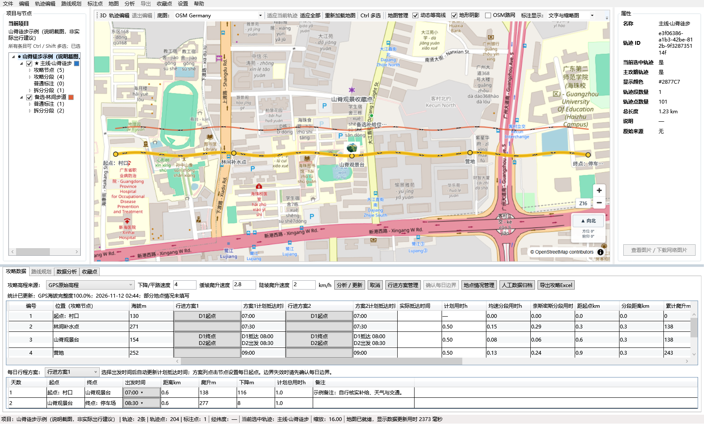

### 2.2 界面分区

上方左侧是“项目与节点”，中间是地图，右侧是“属性”。下方通过“攻略数据、路线规划、数据分析、收藏点”标签切换功能。最底部状态栏显示操作状态、鼠标经纬度、当前选中轨迹、地图缩放和地图加载信息。

若菜单呈灰色，先检查是否有当前项目、是否选中了适用对象、是否已设置主攻略轨迹，以及后台操作是否仍未结束。顶层“导出”在当前界面为预留项；实际轨迹导出使用“文件”菜单或项目树右键，攻略 Excel 导出使用攻略数据面板的按钮。

### 2.3 调整面板大小和表格列宽

1. 将鼠标移到上、下区域之间的横向分隔条。
2. 光标变为上下调整样式时，按住左键上下拖动。
3. 松开后软件记住比例；下一次正常启动继续使用该布局。
4. 上方左侧／地图、地图／属性之间的竖向分隔条同样可左右拖动。
5. 在“攻略数据”和“每日行程方案”表头两列之间拖动，可以调整列宽。双击分隔线可以按内容自动适配宽度；这两种方式都会自动记录。
6. 保存的列宽是全局界面设置，其他项目和以后新建的项目也会沿用，不改变 Excel 模板列宽。

项目树默认从左侧开始显示。遇到长名称时，用底部水平滚动条手动左右拖动；也可将鼠标停在名称上查看完整提示。面板有最小尺寸，不能拖到完全不可见。

### 2.4 查看操作说明和软件信息

1. 点击“帮助 → 操作说明”，在系统浏览器中打开随软件附带的本地说明。正文和截图可以离线阅读，不需要在线网页服务。
2. 点击目录中的模块跳转；点击截图可查看原图。
3. 点击“帮助 → 关于”查看正式软件名称、版本及说明入口。软件显示的版本号以 V 为前缀。
4. 发送或搬移操作说明时保留同一目录的HTML和 `screenshots` 子目录；只发送单个HTML会丢失图片。

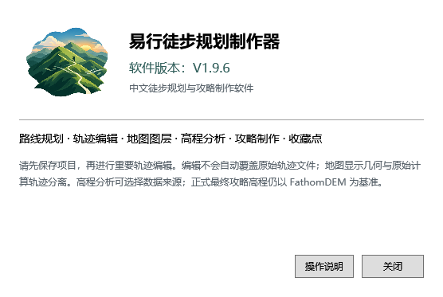

### 2.5 显示、隐藏和恢复面板

1. 点击“设置 → 面板显示”，勾选需要显示的面板，取消勾选则隐藏。
2. 可分别控制项目与节点、地图、属性、攻略数据、路线规划、数据分析、收藏点及状态栏。隐藏面板不会删除其中的数据。
3. 拖动上下或左右分隔条调整大小；面板显隐与比例会自动保存，切换项目和重新启动均沿用。
4. 点击“设置 → 面板显示 → 恢复默认面板布局”恢复默认显隐和比例，不重置表格列宽。
5. 从菜单打开数据分析、收藏点，或开始路线规划时，所需面板会重新显示。

## 3. 新建、打开、切换、保存与恢复项目

### 3.1 新建项目

1. 点击“文件 → 新建项目”，或在项目面板空白处右击选择“新建项目”。
2. 在“项目名称”输入易于识别的名称。
3. 点击“浏览”，选择项目保存位置。
4. 点击“创建”，新项目出现在左侧项目树。

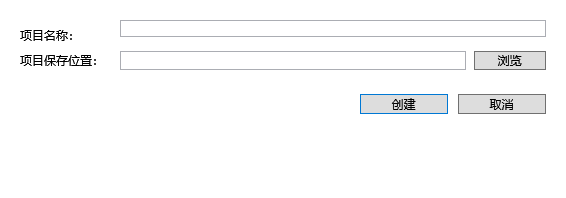

### 3.2 打开多个项目

1. 点击“文件 → 打开项目”，或在项目面板空白处右击选择“打开项目”。
2. 在文件选择器中选择 `.hikeproj`。按住 Ctrl 可选择多个不连续文件，按住 Shift 可选择连续文件。
3. 确认打开，软件依次加载；个别文件失败不会替其他文件强行创建空项目。
4. 左侧点击项目名称或其子项，切换当前项目。当前项目名称以明显的选中样式显示。
5. 同一路径的项目已打开时，再次打开只激活现有实例，不会丢掉尚未保存的修改。

地图显示当前项目的全部可见轨迹，不同时混入其他项目的轨迹。全局三层地图和收藏点不因切换项目改变。

### 3.3 保存与关闭

1. 点击“文件 → 保存项目”或按 Ctrl+S，保存当前项目。
2. 需要副本时使用“文件 → 项目另存为”，选择新的 `.hikeproj` 文件名。
3. 项目名称后的 `*` 表示有未保存修改；仅高亮选择或更改全局图层并不代表修改了轨迹。
4. 在项目名称上右击“关闭项目”，或使用文件菜单的同名操作。出现未保存提示时按实际需要选择保存或不保存。
5. “关闭项目”只从工作区移除，不删除磁盘项目文件，也不删除原 GPX/KML/KMZ。

不要只依赖自动保存：完成重要编辑、人工输入和图片下载后主动 Ctrl+S，再关闭软件。软件保存时使用临时文件校验和安全替换；已有项目通常保留 `.bak` 备份。异常退出后若提示存在较新的恢复数据，请先核对项目名称和时间，再选择恢复，不要覆盖唯一副本。

## 4. 导入 GPX、KML、KMZ 和多条轨迹

### 4.1 选择文件并预览

1. 先选择要导入到的当前项目。
2. 点击“文件 → 导入GPX、KML、KMZ…”。
3. 在文件选择器中用 Ctrl／Shift 多选多个文件，点击打开。
4. 软件解析后进入“轨迹与标注点导入”窗口，检查轨迹名称、段数、点数和距离。
5. 在“导入”列勾选要保留的轨迹；可用“全选轨迹”“反选轨迹”。单轨迹文件使用文件原名称（不含扩展名）；重名用不同内部身份区分，不需要人为改名。一个KMZ中的多条内部轨迹作为一条父轨迹导入，父轨迹使用KMZ文件原名称，各内部轨迹按原顺序显示在“拆分分段”下，分段名称保留内部轨迹名称。

有间隙的多段轨迹会出现“路线性质”选择。确认这些分段是按顺序组成同一次行进时，选“一条行进路线”；独立路线放在一起保存时选“轨迹合集”。这一步决定能否使用公里标识，不会自动补画断口或修改原始点。明确选为一条行进路线后，即使间隙超过1公里也可设置公里标识；间隙只在公里标识中按直线计程，详见第6.11节。

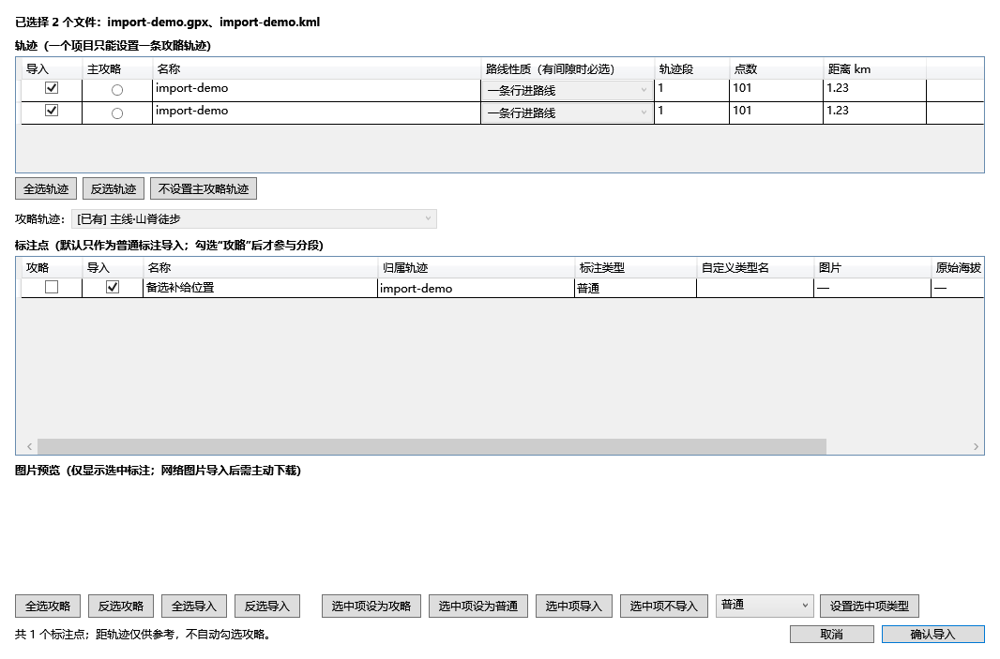

### 4.2 选择唯一主攻略轨迹

1. 新项目导入时，“主攻略”默认不选择，新轨迹按普通轨迹导入。需要设置攻略主线时，在轨迹表“主攻略”列手动点选一条轨迹；也可点击“不设置主攻略轨迹”取消选择。
2. 核对“攻略轨迹”下拉框显示的目标。
3. 当前项目已有主攻略轨迹时，新增普通轨迹不会自动建立第二条主线；若需要换主线，之后在项目树中明确操作。

### 4.3 普通标注与攻略节点的导入

1. 在标注表“导入”列选择保留哪些标注。
2. 默认标注只作为普通参考点。希望参与攻略分段的点，勾选“攻略”列。
3. 核对“归属轨迹”。一个来源文件明确只有一条对应轨迹时，标注可挂在该轨迹下；多轨文件无法可靠确定归属时，请在预览中手动选择，软件不根据名称或距离偷偷猜测。
4. 有多个点需要同样处理，可多选后用“选中项设为攻略”“选中项设为普通”“设置选中项类型”。
5. 选为攻略节点的点归主攻略轨迹并进行精确吸附；未设置主攻略轨迹时不能形成有效攻略分段。
6. 含图片的点可查看下方图片预览。确认导入后，软件会在后台限并发准备标注缩略图；网络图片先缓存到本机，不因预取自动加入项目原图。失败时暂用圆点，点击图片入口可重试。
7. 检查数量后点击“确认导入”。点击“取消”不会提交本次导入。

再次导入是追加，不会替换当前轨迹。导入来源海拔只是原始记录，不等于最终攻略海拔。

**合并KMZ的目录结构：** 导入后展开父轨迹，再展开“拆分分段”，可以像软件内拆分得到的分段一样进行选择、反转、合并和连接。内部物理断点不补线，全部原始点保留，普通标注及本地／网络图片引用归属父轨迹。原KMZ文件不改写。KML和GPX多轨迹文件仍保持原多轨迹导入规则，此变化仅针对KMZ工作区导入。

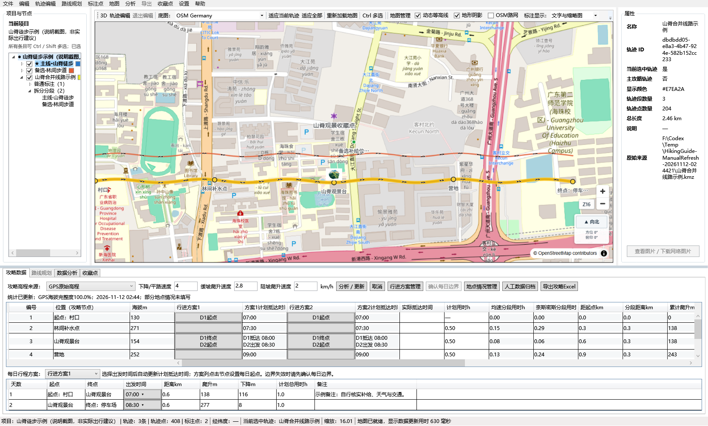

### 4.4 导入后管理轨迹

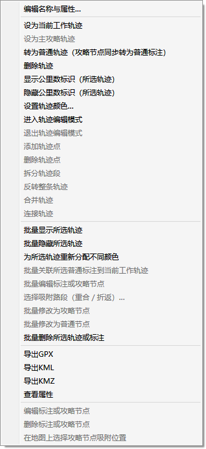

1. 展开项目和轨迹，查看其攻略节点、攻略分段、普通标注及拆分分段。
2. 用轨迹前的复选框控制地图显示或隐藏；所属普通标注、攻略节点和攻略分段一起隐藏，重新显示轨迹后恢复，数据不会因此删除。未关联标注不受轨迹隐藏影响。
3. 轨迹右击“设为当前工作轨迹”，切换编辑对象；右击“设为主攻略轨迹”指定攻略主线。
4. 右击“设置轨迹颜色…”打开颜色选择器，直接选择颜色并确认。导入轨迹默认分配不同颜色，后续可自行修改。
5. 按 Ctrl／Shift 可多选项目树条目。批量菜单只处理当前项目中适用于该操作的对象，例如批量显隐、重新分配颜色、修改节点身份或删除。

“未关联标注”通常接收删除轨迹后仍保留的标注，也会接收本身缺少可靠归属的标注。删除轨迹前软件会提示依赖；删除主攻略轨迹不会自动猜另一条主线，节点和人工内容保留为需要重新确认的状态。

### 4.5 编辑主攻略轨迹前后的身份转换

1. 在项目树找到带主攻略标识的轨迹，右击“转为普通轨迹（攻略节点同步转为普通标注）”。
2. 阅读确认提示并点击“是”。该轨迹不再是主攻略；其所属攻略节点变为同ID的普通标注，仍在这条轨迹下。节点图片、网络图片链接、原始坐标与人工节点信息随点保留，旧攻略分段的人工内容归档。不是把这些点丢到“未关联标注”。
3. 展开“普通标注”核对数量，进入轨迹编辑模式，按需要拆分、合并或连接。主攻略轨迹及其分段不会出现在合并／连接候选列表；若仍选中主攻略，相关命令不可执行。
4. 合并／连接时，“删除原有轨迹”默认勾选。参与删除的轨迹或分段所属普通标注随本次操作转到新轨迹，其余标注留在保留的分段所属轨迹下。图片不需重新添加。
5. 编辑完成，右击最终需要的普通轨迹，选择“设为主攻略轨迹”。确认后，这条轨迹的全部所属普通标注同步转为攻略节点，并在完整几何上重新吸附、排序和生成攻略分段；距离较远的点会另行提醒确认。请先检查哪些点需要参与攻略，避免将不需要的标注留在该轨迹下。
6. 一个项目仍只允许一条主攻略轨迹。若直接把另一条普通轨迹设为主攻略，确认提示会说明：原主攻略与其节点先同步转成普通轨迹、普通标注，再把新主攻略的所属标注转为攻略节点；不会把旧主攻略节点直接吸附到另一条不相关的轨迹。
7. 每次身份转换都可一次撤销／重做；合并／连接与身份转换是分开的历史操作。若连续执行“转普通 → 编辑 → 转主攻略”，撤销时按相反顺序恢复。转换和编辑后重新核对节点、每日起终点及人工分段内容，再更新分析；不能把已归档的旧分段人工数据未经核实当成新分段数据。

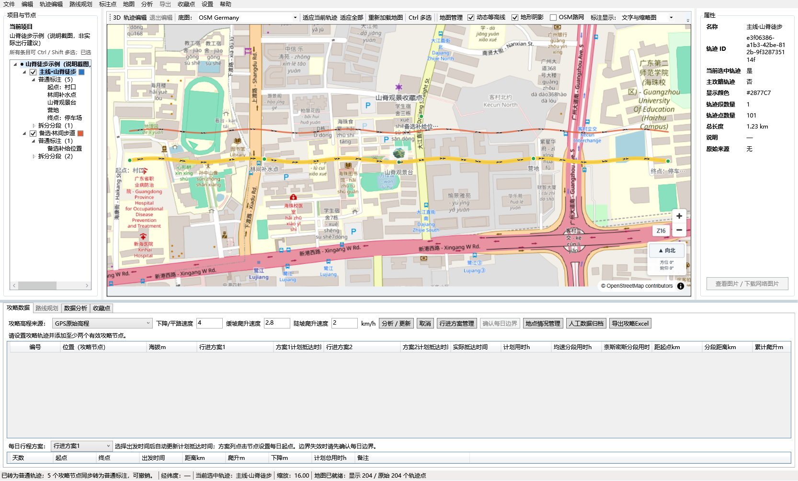

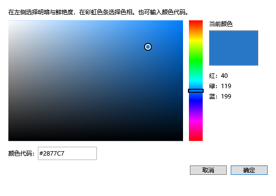

## 5. 标注、攻略节点、吸附和图片

### 5.1 新增或编辑点

1. 在地图所需位置右击，选择“在此添加普通标注”或“在此添加攻略节点”；也可使用顶部“标注点”菜单进入添加模式，再在地图点击位置。创建后立即打开该点的编辑窗口，可直接填写名称、描述、类型及归属；取消编辑保留刚创建的点，若不需要该点可撤销添加或删除。
2. 填写名称和描述。
3. 选择标注类型；选择“自定义”时填写自定义类型名称。
4. 根据用途勾选或取消“设为攻略节点（参与排序与分段）”。普通标注可指定所属轨迹，攻略节点使用主攻略轨迹。
5. 点击“确定”。添加位置选择尚未结束时，Esc 可取消。
6. 已有点可在地图右击选择编辑，或在项目树右击“编辑标注或攻略节点”。

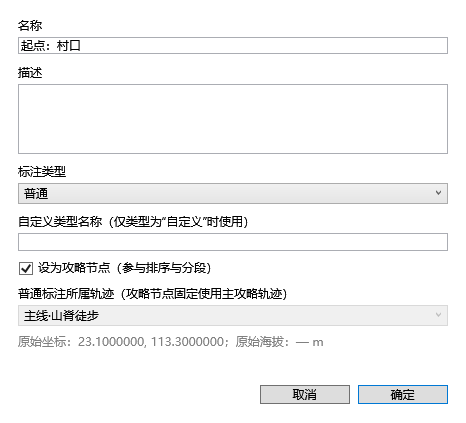

普通标注为绿色、攻略节点为黄色。随着地图放大，图标逐渐变大，达到上限后保持；这只是显示效果，不影响真实坐标。

### 5.2 互转和批量互转

**批量编辑标注或攻略节点：** 在项目树按Ctrl／Shift多选普通标注点或攻略节点（可混选），右击“批量编辑标注或攻略节点”。窗口显示本次处理的普通标注和攻略节点数量。勾选“修改名称”“修改描述”或“修改标注类型”，填写新内容；选择自定义类型时还需填写自定义类型名称。未勾选字段保留各点原值；勾选名称或描述后留空表示明确清空。

需要统一身份时，先勾选“修改节点身份”，再勾选“设为攻略节点”以吸附到当前主攻略轨迹；不勾选“设为攻略节点”则统一转为普通标注。没有主攻略轨迹时不能设为攻略节点，较远点提交前会提示确认。需要指定普通标注归属时，勾选“修改普通标注所属轨迹”，在下拉框选择项目内轨迹或“未关联标注”。该归属只应用于修改后仍为普通标注的点，不移动坐标；攻略节点始终归属主攻略轨迹，统一设为攻略节点时此项禁用。点击“应用修改”，图片与人工内容保留，取消不会修改，完成后可一次撤销身份、归属和其他字段。此功能不批量编辑轨迹本身。

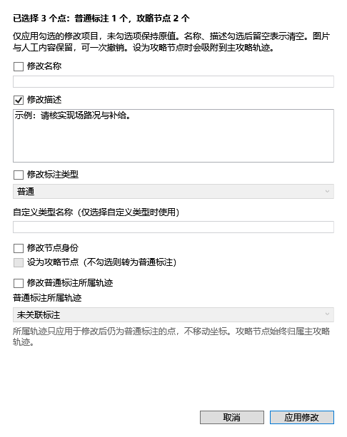

1. 在地图普通标注上右击“转为攻略节点”，使其参与主攻略轨迹排序。
2. 在攻略节点上右击“转为普通标注点”，取消参与攻略。
3. 批量处理时在项目树按 Ctrl／Shift 多选相应点，再右击“批量修改为攻略节点”或“批量修改为普通节点”。
4. 名称、说明和图片仍保留；但节点关系改变后，攻略分段及人工数据可能需要重新核对。

### 5.3 吸附到轨迹

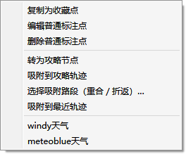

1. 右击标注或攻略节点，选择“吸附到攻略轨迹”：在主攻略轨迹完整原始几何上找最近位置，地图坐标和项目树归属同步调整。
2. 普通标注还可选择“吸附到最近轨迹”：优先使用其可见的所属轨迹上的最近位置；所属轨迹隐藏、不存在或没有有效线段时，在当前项目可见轨迹中找最近线段，不限主攻略轨迹；处理后归到该轨迹下。不吸附到隐藏轨迹。明确选择“吸附到攻略轨迹”时，仍只吸附到可见主攻略，主攻略隐藏时需先显示；攻略节点不跨主攻略转移。
3. 若自动吸附落到折返、自交或并行路段的错误经过位置，选中攻略节点后用“标注点 → 选择轨迹位置”或项目树的“在地图上选择攻略节点吸附位置”，再点击真正应归属的线段。
4. 超过默认 50 米吸附告警距离时，先核对原始位置和目标路线再确认；这不是硬性禁止距离。
5. 修改后查看属性面板中的原始坐标、吸附坐标、距起点和状态。

吸附计算使用完整轨迹，地图为流畅显示做的简化点不参与吸附。攻略节点按吸附位置的累计里程自动排序，不按导入文件中的出现顺序。两个相邻有效节点生成攻略分段，名称默认“前一节点 → 后一节点 距离”；无名称图片节点使用“未命名节点”。

灰色／失联节点意味着它的轨迹关系不再有效，不是内容已被删除。先确认主轨迹和实际位置，再重新吸附或手动选择位置；不要直接将失联点当作正确里程节点使用。

**重合、折返路段选择吸附：** 同一地图位置可能对应去程和回程不同的轨迹里程。普通最近吸附不能仅凭坐标区分它们。

1. 在地图上右击普通标注或攻略节点，选择“选择吸附路段（重合／折返）…”。项目树选中点后右击也有同一入口。
2. 普通标注优先使用可见所属轨迹，否则使用可见最近轨迹；攻略节点只使用可见主攻略轨迹，不吸附到隐藏轨迹。
3. 在弹出的候选表查看“距起点 km”“距终点 km”“距标注 m”。去程通常距起点较小，回程通常距起点较大、距终点较小；请按行程实际顺序选行，不按地图坐标是否相同判断。
4. 点击“吸附到选中路段”。普通点保留普通身份与该轨迹归属，属性面板显示已选路段里程；攻略节点使用选中里程重新排序、重建攻略分段。可撤销本次吸附，取消窗口不改变点。
5. 保存项目。选择随项目重开保留，普通标注转为攻略节点（含批量和整轨角色转换）继续使用该选择；轨迹几何未变时再次吸附不会退回去程。
6. 修改、反转、连接或裁剪轨迹后，旧位置的几何指纹不再有效，需要重新核对并选择路段；普通点被拖动后也会清除旧选择。该选择用于本软件项目，GPX/KML中的同坐标普通点不能向任意第三方APP保证相同里程绑定。

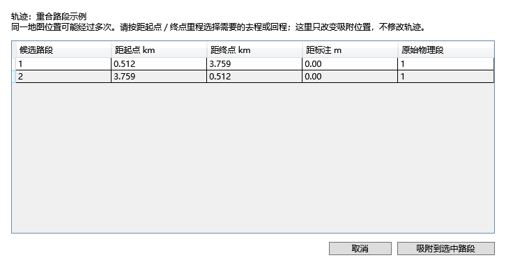

### 5.4 查看、下载和另存图片

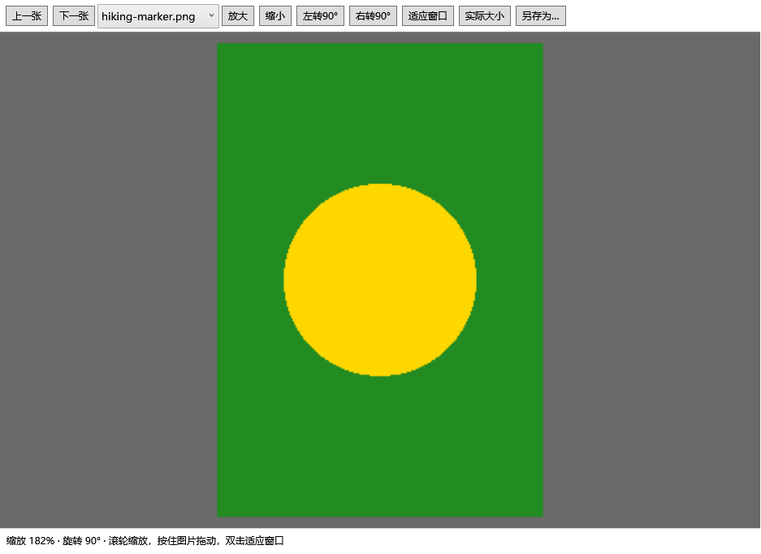

1. 点击地图上有图片的标注，弹窗直接显示约240像素宽的预览图、完整名称和文字说明。也可从属性面板打开图片。
2. 点击“查看图片”或“下载并查看”，直接进入统一图片查看器。网络图片自动下载或复用本机缓存，下载失败显示原因，关闭后可重新打开重试。
3. 轨迹标注图片查看器中的“上一张”“下一张”，按轨迹起点到终点顺序切换到同一轨迹上有图片或图片链接的标注，跳过无图片点，不跨轨迹；到达首尾后对应按钮禁用。未关联轨迹的标注不使用这两个按钮。当前标注的多张图片用图片名称下拉框选择。收藏点图片查看器的“上一张”“下一张”仍只切换当前收藏点的图片。使用“放大”“缩小”“适应窗口”“实际大小”及旋转按钮查看图片；滚轮缩放，按住图片拖动，双击适应窗口。
4. 用“左转90°”“右转90°”旋转。点击“另存为…”可选择JPG或PNG并指定电脑上的保存位置；保存的是原分辨率图片及当前旋转方向，不按查看时的缩放比例缩小。JPG中的透明区域使用白色背景。
5. 网络原图在查看成功后自动加入当前项目，无需再次点击保存到项目。完成后仍需保存项目文件，才能可靠地将原图保存在 `.hikeproj` 中。

关闭查看器保留项目树展开状态。缩略图预取只写图片缓存，不改变原始轨迹、标注、人工内容或项目图片附件；无效链接失败时不写入空图片。私网地址、无效图片及过大的网络响应仍会被拒绝。

拖动、旋转或改变地图俯仰时，图片信息弹窗自动隐藏；再次点击标注可重新打开。

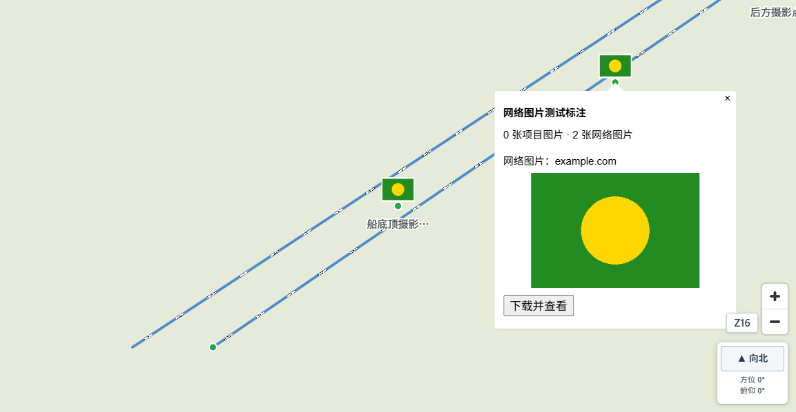

### 5.5 选择地图标注的显示方式

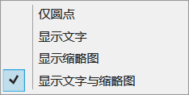

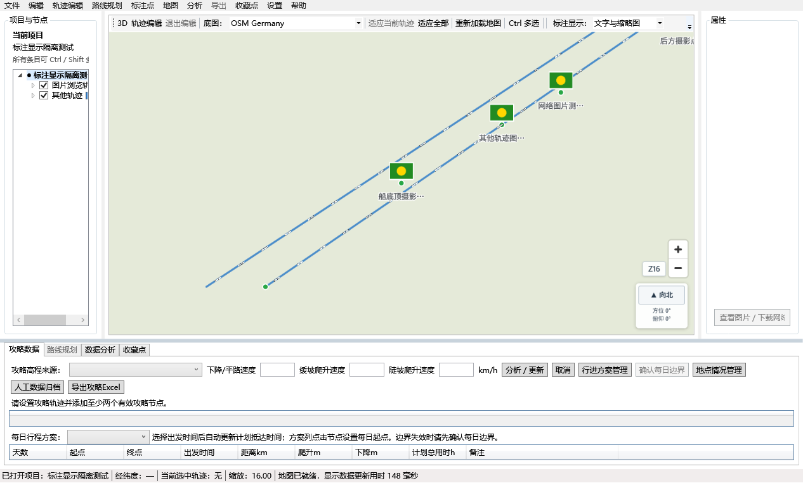

1. 从菜单栏“标注点 → 显示方式”选择“仅圆点”“显示文字”“显示缩略图”或“显示文字与缩略图”。默认是“显示文字与缩略图”；菜单勾选项与地图上方“标注显示”下拉框保持同步。设置会自动保存，普通标注和攻略节点共用，并应用到其他项目。
2. 选择以下一种方式：

| 方式 | 显示内容 |
|---|---|
| 仅圆点 | 保留普通点的绿色圆点、攻略节点的黄色圆点及选中高亮 |
| 文字 | Z12起显示名称；没有名称时只显示圆点；超过5个字用省略号，鼠标悬停显示完整名称 |
| 缩略图 | Z14起显示小图片；没有图片或图片暂不可用时保留圆点 |
| 文字与缩略图 | 同时采用以上文字和图片规则 |

3. Z12以下不显示名称，Z14以下不显示缩略图，圆点沿用原有缩放规则。名称缺省的“未命名标注”等占位文字不作为地图名称显示。
4. 近处缩略图采用约32—48像素宽的小卡片；图片和文字有碰撞避让，密集时部分卡片不显示，仍可点击圆点查看。3D中图片和文字保持朝向屏幕，远处适当缩小并避让，减少遮挡。

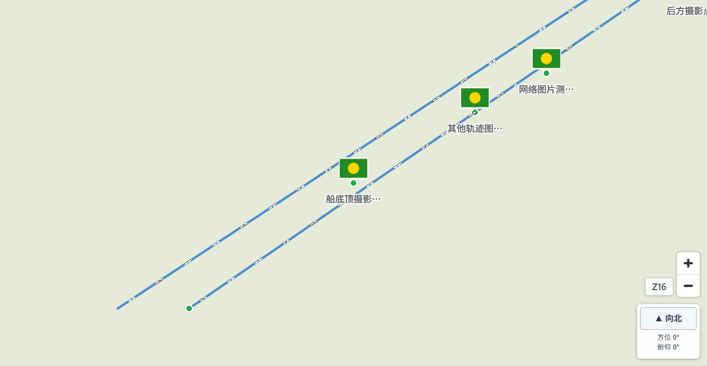

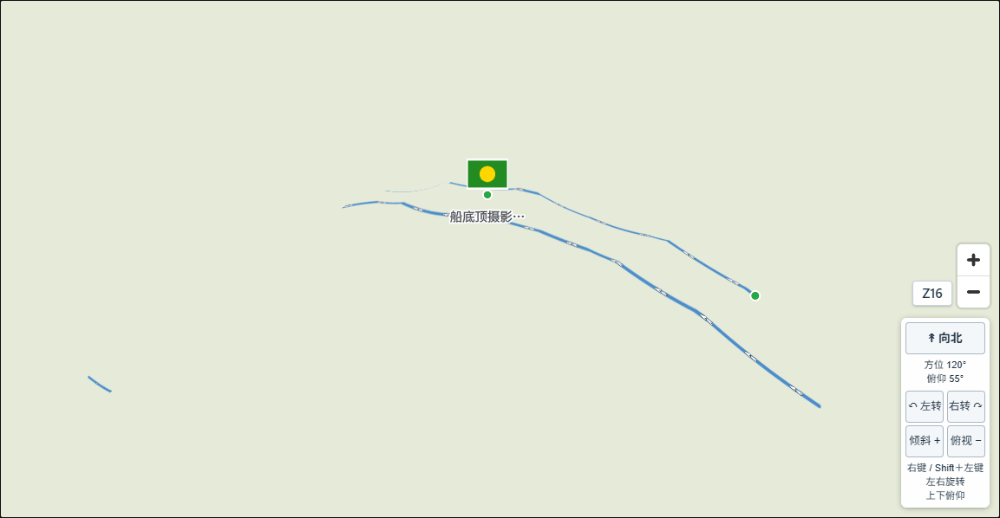

## 6. 地图操作与全局三层 XYZ 图源

### 6.1 日常地图操作

1. 拖动地图平移，滚轮或地图控件放大／缩小。
   点击地图使其获得键盘焦点后，可按 W／A／S／D 向上／左／下／右平移；按住可连续移动。地图区域按物理按键识别，不必先切换到英文输入法。返回文字输入框后正常输入，Ctrl、Alt 等组合键不会触发移图。3D中平移保留当前方向与俯仰。

底图和在线叠加层使用独立下载通道，优先复用已下载的PMTiles和瓦片缓存。拖动、缩放及3D旋转时，已显示的叠加图层、动态等高线、地形阴影和OSM路网持续显示；新区域的数据随加载逐步补齐，不会为了等待底图而统一隐藏图层。各图层是否显示仍由地图工具栏及地图管理中的勾选设置控制。
2. 点击地图中的轨迹或拆分分段只更新选择高亮；地图左击、右击轨迹都不自动“适应全轨迹”，当前视角保持，便于直接编辑。
3. 确实需要查看整条线路时，主动点击“适应当前轨迹”或“适应全部”。
4. 选择项目树、攻略表节点或收藏点时可能主动定位对应对象；这与地图线条点选保持视角是不同操作。
5. 地图空白处右击可以新增标注、收藏点、复制“纬度, 经度”和查询当前位置天气。
6. 地图初始化异常时，使用“地图 → 重新加载地图”；不要为解决瓦片网络失败删除项目。

**轨迹显示精度与方向标记**

- 地图缩放到 **Z15、Z16、Z17、Z18、Z19、Z20……** 时，按完整轨迹点显示；缩小到 **Z14、Z13、Z12……** 时，才使用轻度抽稀。右下角缩放按钮左侧可以查看当前层级。
- 低层级按偏差容限保留线路形状，不按固定倍数机械删点：Z13～Z14使用0.75米容限，Z11～Z12为3米，Z7～Z10为8米，Z6及更小层级为25米。小数层级在Z15之前仍属于抽稀范围。
- 轨迹底色、攻略分段覆盖色、选中高亮与方向标记使用同一份线条位置。3D模式也按当前画面的缩放层级统一选择精度，不因地形瓦片同时出现不同细节层级而分别抽稀。
- 双尖角方向标记位于轨迹中间，沿轨迹方向绘制并贴合3D地形。亮色轨迹使用黑色标记，暗色轨迹使用白色标记，并加反色细边；攻略覆盖色及选中高亮也会参与颜色选择。间距按显示尺度和线段位置自适应，不固定为12米；急弯、过短线段及分块端部会留白，优先在较平顺的位置显示完整标记。
- 软件只将视野及周边缓冲范围内的轨迹分块提交给地图。拖动地图后自动补入进入视野的部分；放大回Z15及更大层级恢复完整精度。显示优化不改变原始轨迹、统计、攻略节点或导出文件的精度。

### 6.2 配置底图和两个叠加层

1. 点击“地图 → 地图管理”，打开“地图管理”。
2. 在“底图”选择一套图源；底图始终显示，可调透明度。
3. 在“叠加层1”“叠加层2”选择适用图源，并勾选“显示”。上层压在下层上，轨迹、标注和收藏点仍在地图瓦片上方。
4. 拖动各槽位透明度滑块，百分比即时变化。通常先降低叠加层不透明程度，观察下层是否仍可辨认；不需要叠加时选择“无”或取消显示。
5. 同一图源不能同时占用两个槽位，即使其中一个隐藏也不允许重复。
6. 更改立即预览并自动保存。关闭管理器、切项目、关闭全部项目或重启后仍使用同一组合，不写入项目，也不改变当前地图中心／缩放。
7. 地图顶部“底图”下拉框是同一全局底图的快捷选择，不是另一套项目级图源设置。

初次建立三层配置时使用 OSM Germany 底图，两个叠加层为空。某个叠加源失效只影响该层；禁用或删除当前图源时，底图安全回退，叠加槽位清空。显示图源的版权说明在地图组合显示，隐藏层不贡献署名。

### 6.3 新增或编辑 XYZ 图源

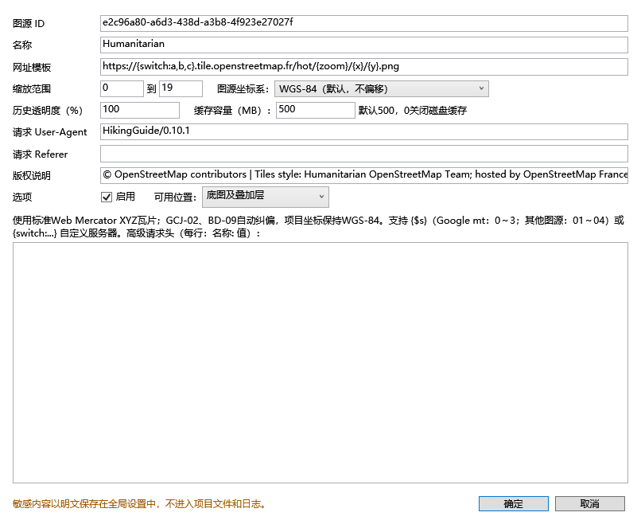

1. 在地图管理“在线图源库”点击“新增”，或选择已有图源点击“编辑”。
2. 填名称与“网址模板”。必须有 `{z}` 或 `{zoom}`，以及 `{x}`、`{y}`。
3. 填缩放范围：支持 0～24，最小值不能超过最大值；还要符合服务商真正提供的层级。
4. 设置“可用位置”为底图、叠加层或两者均可，并勾选启用。
5. 填真实的版权说明；如服务要求，再填 User-Agent、Referer 或高级请求头，每行“名称: 值”。不需要鉴权时保持空白。
6. 点击“确定”，再在图源库中点击“测试各服务器”，阅读每个服务器结果；部分成功不等于全部可用。
7. 测试通过后在上方槽位中选择该源。

多服务器有两种写法：

- `{$s}`：带美元符号。Google的`mt{$s}.google.com`自动使用0、1、2、3号服务器；其他图源使用01、02、03、04。只有服务方确实提供这些编号时才使用此写法。
- `{switch:a,b,c}`：自行明确列出服务器，例如`https://{switch:a,b,c}.tile.openstreetmap.fr/hot/{zoom}/{x}/{y}.png`。一个模板只支持一组服务器切换，至少两个不同且非空的成员；成员前后空白会规范化。服务方使用1、2、3、4时，应写`{switch:1,2,3,4}`。

普通`{s}`（没有美元符号）、`{-y}`、quadkey、嵌套或多组switch不受支持。多服务器属于一个图源，不需要为每个服务器建立重复图源。

编辑器的“历史透明度”仅兼容旧配置；当前实际透明度在上方三个槽位设置。高级请求头可能含令牌，当前以明文保存在本机全局配置：仅在可信电脑使用，分享设置截图和备份前移除敏感信息。网络、证书、DNS 或服务商限额问题可能使瓦片失败；在线底图可用并不代表 BRouter 路由数据已安装。

### 6.4 每个图源的地图瓦片缓存

1. “地图 → 地图管理”中点击“新增”或选中图源点击“编辑”。在“缓存容量（MB）”手动输入容量，默认500，输入整数，0表示关闭磁盘缓存。
2. 点击“确定”，图源库自动保存设置；管理列表的“缓存容量MB”列可查看每个图源设置。以后可再次编辑修改，新旧图源都适用；旧配置缺少该字段时按500MB使用。
3. 已浏览且未过期的瓦片按图源保存；便携程序在`Data\MapTileCache\图源ID`下，安装程序在当前个人数据目录内（位置见第18.2节）。再次平移、缩放或重开软件时优先读缓存，同一图源多服务器复用同一瓦片；不同图源独立容量，互不占用额度。
4. 超额按较早写入顺序删除缓存瓦片；降低容量会立即清理到新限额，0会清空该源已存瓦片并停止磁盘缓存。不会删除项目、轨迹、收藏图、DEM或BRouter数据。MB按1024×1024字节计算，限额统计缓存文件大小。
5. 修改图源网址或鉴权请求头后使用新的缓存身份，不串用旧配置瓦片。服务器给出的有效期优先，无有效期时默认24小时；到期重新下载，明确禁止缓存的响应不保存。失败响应、非图片错误页面不缓存。缓存目录无法写入时仍尝试正常在线显示。

缓存只保存已经浏览的瓦片，不自动批量下载整个地区；它不是完整离线地图。图源“测试各服务器”仍直接检查网络，不用缓存冒充服务器在线。

### 6.5 动态等高线与地形阴影（等高线生成器）

本节按当前Windows 10/11版界面讲解。打开“等高线生成器”标签，标题为“动态等高线（独立叠加，不占用在线图源位置）”。等高线按当前视野动态绘制，不需要先生成整片山区的线条。Windows 7兼容程序的可用控件请以实际安装包为准。

1. 打开“DEM管理”，挂载TIF／HGT数据库并完成扫描，确认高程单位为米。
2. 打开“地图 → 地图管理 → 等高线生成器”，点击“选择统一DEM”。在地形设置窗口选择高程来源；3D地形、等高线和阴影共用此选择。2D也采用该DEM，无需勾选启用3D。更换此来源会同时影响三项地图效果，不改变轨迹分析、攻略或收藏点的高程来源。
3. 勾选“显示等高线”，点击普通线和主线的颜色按钮分别选色，用“透明度”滑块调整整组线条和数字的显示程度。
4. 设置两档等高距：默认Z13—Z14为100米，Z15及以上为10米。等高距输入1—10000的整数米数。Z13以下隐藏等高线。 3D倾斜观看时，近景使用这里的设置，中景固定采用100米、远景固定采用200米等高距，不受这两项输入影响；默认设置下，Z13—Z14为100/100/200米，Z15及以上为10/100/200米。分区围绕地图当前定位中心，按水平地面距离划分，不按画面上下位置划分。Z15在纬度25度附近，近景完整细节范围约3.5公里，3.5—4.55公里渐变到中景，10.5—14公里渐变到远景；范围随缩放和纬度调整，近景完整细节半径不小于2公里。旋转或改变俯仰不会把同一地面位置重新划入另一距离分区。俯视时恢复当前层级的常规等高距。
5. “主等高线间隔”默认50米。只有已存在且海拔为该值倍数的线才采用主线样式，不额外增加线条。负海拔同样判断，0米线始终不绘制、不标注。普通线宽默认1.7像素，主线宽默认3.4像素，可分别调整。
6. “圆滑等高线”默认开启，减少弯曲处的折角，数字标注也跟随同一条线。关闭后采用较简单的插值，便于比较效果。两种方式都保留原始DEM，不增加测量精度；在缺测边界不跨空白区域补线。
7. 勾选“显示地形阴影”，用“叠加强度”调整暗部深浅，默认30%。平坦和受光部分保持透明，背光部分自然渐变；光照方位315°、高度45°。
8. 点击“应用并保存等高线生成设置”。这些设置对2D和3D共用、全局保存，切换项目不会改变，也不占底图及两个在线叠加层的位置。

等高线和阴影只表示所选DEM的地形。放大地图不会增加DEM原有精度。缺测处不填0，不绘制虚假的海平面线；没有有效来源时，请先检查统一地图DEM。

“高程采样缓存”默认2048MB（2GB），保存可复用的高程数据；“地形阴影缓存”默认1024MB（1GB），单独保存阴影瓦片。均可输入容量，0表示不保留对应磁盘缓存。改变等高距、主线间隔、颜色、线宽和透明度会直接更新显示，无需重新读取DEM。

清除缓存：点击对应的“清除高程采样缓存”或“清除阴影缓存”，确认后只清所选类别，不删除原始DEM、项目、在线地图、离线地图或3D地形缓存。清理高程采样缓存也释放当前等高线的内存数据，之后按视野重新加载，因此缓存可能很快再次增长。更换DEM文件后，请在DEM管理重新扫描。

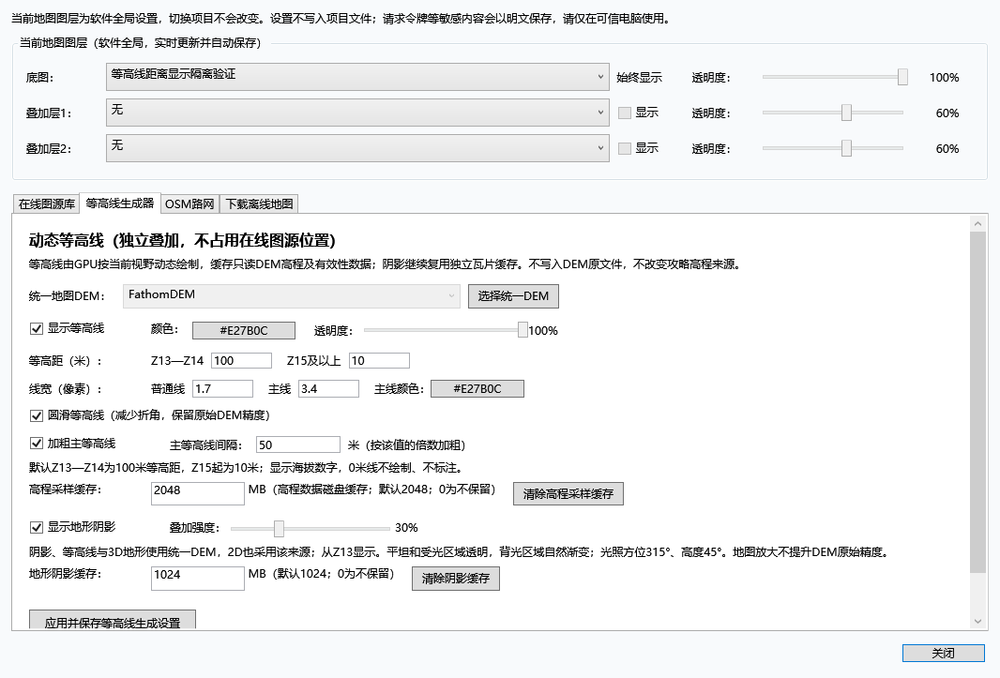

### 6.6 DEM 3D地形：进入、观察和安全退出

3D仅改变地图的几何表面和观察角度，不改写轨迹、标注、收藏点坐标、攻略统计或原DEM。它不下载网络高程，也不使用GPX／BRouter海拔补洞。最终攻略的FathomDEM计算规则保持不变。

1. 在DEM管理中挂载并扫描一套有当前地区覆盖的TIF或HGT。打开“地图 → 3D地图…”。
2. 在“3D地图设置”中选择地形DEM。下拉项会说明格式、实际分辨率和原生最高瓦片层级。不能读取的数据库不会成为可用选择。
3. 先把地图放大到该DEM原生层级加1或以上，再勾选“启用3D地形”。请按设置窗口显示的原生层级选择合适的地图缩放；过大的视野会安全回2D，不伪造无覆盖地形。
4. 点击确认，首次生成需要等待。地图工具栏按钮随实际状态显示“2D”（点击返回2D）；未启用时显示“3D”。如果瓦片缺测或DEM失联，状态回到2D并显示原因，请检查覆盖与连接后重新启用。
5. 普通左键拖动平移、滚轮缩放。3D下按住鼠标右键拖动，或按住Shift＋左键拖动：左右移动连续旋转方位，可绕行360°及多圈；向下拖增加倾斜，向上拖更接近俯视，俯仰范围0—85°。围绕当前地图中心观察，不自动缩放至整条轨迹。右键轻点仍打开原有操作菜单；右键拖动后不弹菜单。Ctrl＋左击仍用于轨迹多选，不用作旋转。
6. “地形夸张”范围0.5—3，默认显示1.5，精确到1位小数。可在滑块右侧输入，例如1.2、1.4，按回车或离开输入框应用；输入更多小数位会四舍五入，例如1.37变为1.4、1.25变为1.3。滑块每次微调0.1。显示、实际应用及保存精度一致。非法数值或超出范围会提示，不会覆盖已保存值。只夸张可视高度，不改变真实海拔数字。“默认俯仰”默认55°，范围0—85°；很高的俯仰会让远处遮挡、文字拥挤，应适当降低。
7. 2D和3D的等高线与阴影均由等高线生成器控制，DEM统一跟随3D地形所选来源，显隐及强度分别保存。3D设置中的效果控件只回显，修改请进入生成器。等高距、主次线颜色、线宽、透明度和主线倍数间隔与生成器一致。主线与普通线按真实高程着色并一同贴合地形，夸张只改变山体形状，不改变海拔等级。远处等高线自动使用更大的等高距，近、中、远景之间渐变衔接。海拔数字自动控制密度，优先覆盖不同高度与距离分区，减少同一海拔的重复标注。2D模式进一步按窗口面积限制数字数量，增大文字间距，避免同一高度在邻近位置反复出现。3D中的海拔数字保持面向屏幕，避免倾斜和倒置；它们是等高线高度，不是节点名称。
8. 在线底图与两个叠加层仍可使用，不占用新的槽位。进入和退出3D均保持生成器的DEM及显隐设置，3D山体DEM不会覆盖生成器选择。
9. 3D地形缓存默认4GB，在设置中可改为1—50GB。便携程序目录为`Data\TerrainCache`，安装程序位于个人数据目录内，采用无损Terrain-RGB PNG加元数据的`.tile`包，独立按最近使用顺序清理。点击“清空3D缓存”只清此类缓存，不删除DEM、在线瓦片或2D等高线／阴影缓存；当前视野随后会按需重建。

地图右下角提供独立导航卡片：点击“向北”只将方位恢复为0°，保留中心、缩放和当前俯仰，不退出3D，也不会重新锁定向北。3D下还可用“左转／右转”每次旋转15°，“倾斜＋／俯视−”每次调整俯仰10°；角度文字显示当前方位和俯仰。接近正北时不会自动吸回，方便观察任意方向。普通2D下也能点击“向北”。

先点击地图空白处使地图获得键盘焦点，再按N可向北，U只恢复垂直俯视；Shift＋左右方向键旋转，Shift＋上下方向键调整俯仰。设置窗口中的旧“正北朝上”仍同时把方位和倾角归零，“恢复默认视角”恢复正北与默认俯仰；它们与地图卡片的“向北”不同。切换2D保留中心、缩放和方位，只把倾角回0。3D方位和俯仰沿用全局视角保存，重载地图后恢复。

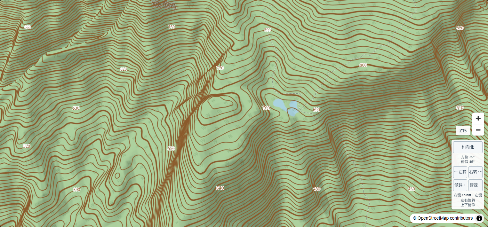

按Ctrl＋左击用于多选轨迹；旋转3D视角请使用右键或Shift＋左键拖动。

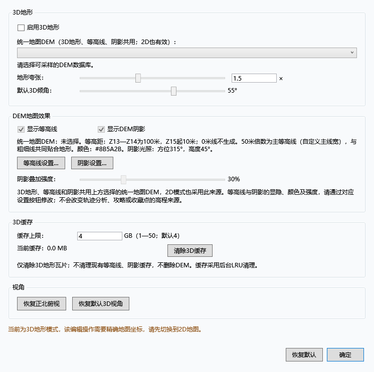

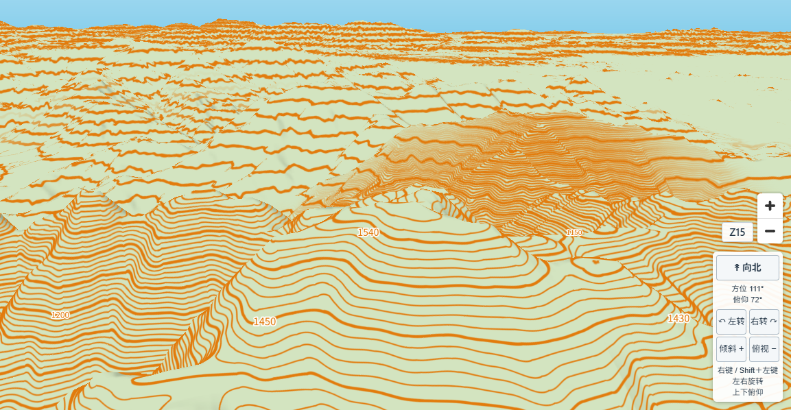

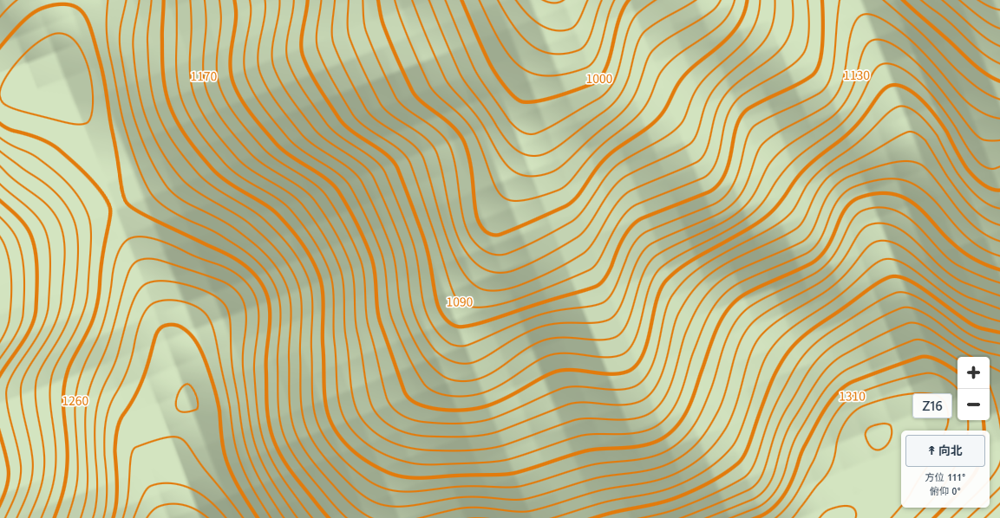

编辑限制：在3D中支持观察、点选、悬浮信息和右键查询；收藏点拖动、普通标注拖动、攻略节点拖动、轨迹点修改、新增标注、新增攻略节点、手绘选点及BRouter选点均须切回2D，相关坐标写入会被拦截。轨迹拆分、区间裁剪、合并连接等几何修改也请在2D执行。不要把屏幕上的高山投影直接当作可靠编辑坐标。

3D设置是软件全局设置，不随项目切换。关闭全部项目仍可查看地形、等高线、阴影及全局收藏点；重新加载地图会恢复状态和相机。真正缺测的瓦片不生成PNG，并安全回到2D，不填0、不换DEM。因此靠近DEM边缘时，即使中心有覆盖，也可能因邻接瓦片缺测回退。

### 6.7 地图工具栏和右下角导航

1. 在地图上方“底图”下拉框选择图源；点击“地图管理”可打开完整设置。
2. 勾选或取消“动态等高线”“地形阴影”“OSM路网”，分别控制三个独立叠加层。快捷开关与地图管理共用设置，在2D和3D中均生效。
3. 右下角从下往上依次为地图署名、向北及3D控制、缩放按钮；缩放按钮左侧显示当前地图层级，例如Z15。
4. 点击“＋／−”或滚动滚轮缩放。点击“向北”恢复正北，保留中心、缩放和俯仰。
5. 3D中点击“左转／右转”每次旋转15°，“倾斜＋／俯视−”每次改变俯仰10°。也可按住右键或Shift＋左键拖动，左右旋转、上下调整俯仰；轻点右键仍打开操作菜单。
6. 当窗口较窄时，顶部工具栏的部分项目可从最右端溢出菜单展开。

### 6.8 调整地形显示的建议顺序

1. 先在“等高线生成器”确认统一DEM有效，再打开动态等高线。若底图本身已含等高线，先隐藏该在线叠加源，避免两套线重叠。
2. 将地图放大到Z15或以上，先观察近处10米等高距；远处过密时降低俯仰，或稍微缩小地图，不必把近处等高距一并调大。
3. 普通线与主线采用相近色系，主线稍粗；用整体透明度让底图地物仍可辨认。0%完全透明，100%完全显示。
4. 再打开地形阴影，从默认30%叠加强度开始调整。它只控制软件根据DEM叠加的暗部，不能移除底图服务商已经画入图像的阴影。
5. 点击“应用并保存等高线生成设置”。取消显示会隐藏相应图层，已有缓存保留。设置对2D和3D共用，完整参数见第6.5节。

### 6.9 图源坐标系与纠偏

1. 打开“地图管理 → 在线图源库”，新增图源或选中已有图源后点击“编辑”。
2. 在“图源坐标系”选择服务方实际使用的坐标系：WGS-84图源选默认项，高德等GCJ图源选GCJ-02，标准Web Mercator XYZ网格的BD-09图源选BD-09。
3. 原生百度瓦片、经纬度投影瓦片、任意投影及非标准瓦片矩阵不能只靠选择坐标系直接使用。
4. 填写网址、层级、服务器和版权说明，点击“确定”；在底图或叠加层中选择该图源。
5. 不同槽位可使用不同坐标系。纠偏只作用于图像显示，不修改轨迹、标注、收藏点、DEM或导出坐标。

### 6.10 清空单个在线图源缓存

缓存容量和有效期见第6.4节。坐标纠偏图源的原始图像和纠偏结果共同计入该图源容量。

1. 打开“地图管理 → 在线图源库”，在列表中选中它，点击“清空缓存”并确认。
2. 此操作不删除图源定义、其他图源或离线PMTiles。当前内存中显示的图块可暂时保留；后续请求按需重新读取或下载。

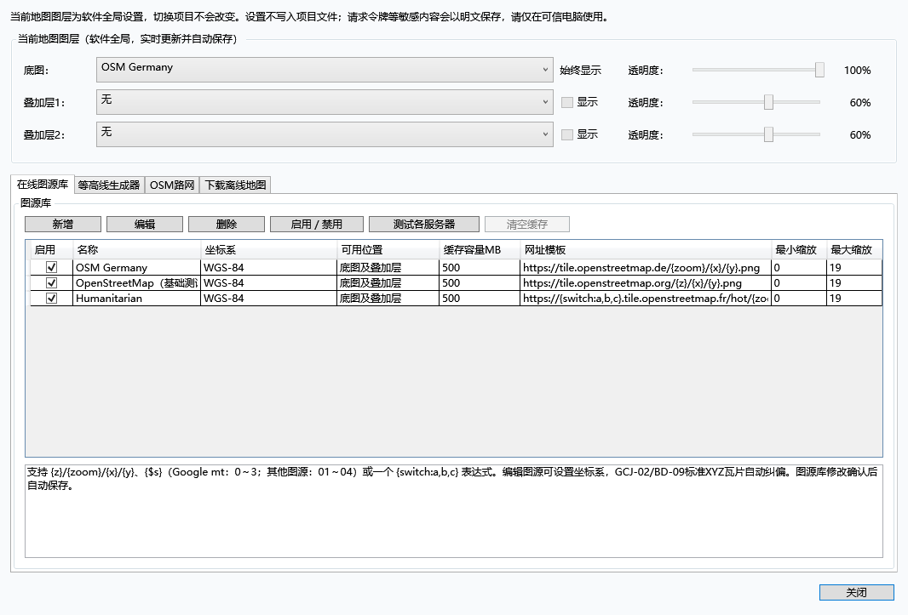

### 6.11 轨迹公里数标识

公里标识默认关闭。启用后沿行进方向显示1、2、3……等整公里数字，不显示起点0；终点显示总公里数，四舍五入保留1位小数。不足1公里的路线只显示终点总里程。标识采用深色水滴和白色数字，尖端对应计程位置。

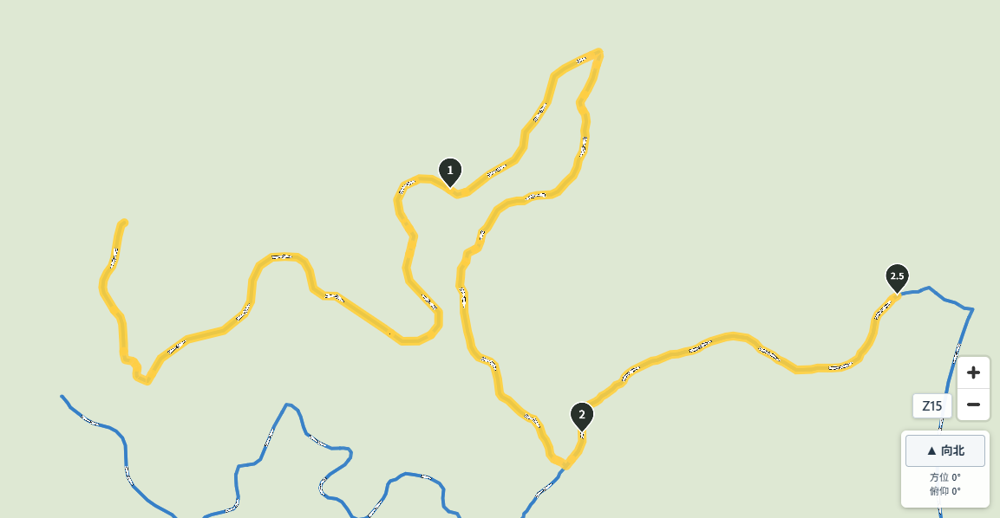

**单条或多条轨迹设置：** 在左侧项目树中选中轨迹，按住Ctrl可多选，右击选择“显示公里数标识（所选轨迹）”或“隐藏公里数标识（所选轨迹）”。在地图上Ctrl多选轨迹后右击，也可使用这两个选项。隐藏轨迹时，其公里标识同步隐藏；重新显示轨迹后按原公里设置恢复。

**整个项目设置：** 右击项目名称，选择“显示本项目轨迹公里数标识”或“隐藏本项目轨迹公里数标识”。批量操作会跳过轨迹合集及不符合条件的轨迹。

**已加载项目批量设置：** 打开“设置 → 轨迹公里数标识…”，勾选需要处理的项目，点击“显示所选项目”或“隐藏所选项目”。这里会列出各项目可设置及已显示的轨迹数；不会自动开启以后新导入的轨迹。

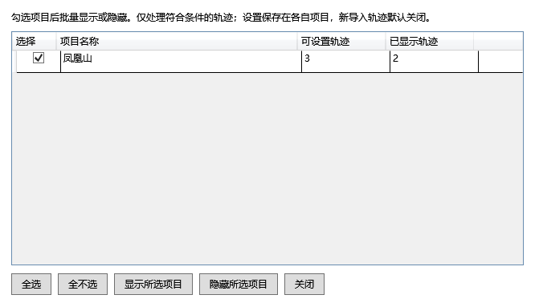

**属性设置：** 右击轨迹 → 编辑名称与属性，可勾选“显示轨迹公里数标识”。有多个分段的轨迹还可选择路线性质；确定为轨迹合集后不提供公里显示选项。设置随项目保存，重新打开后保留，可使用撤销恢复本次修改。

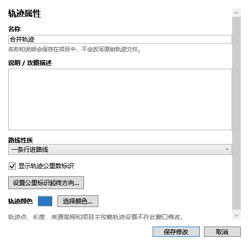

**路线性质和间隙：** 一整条连续路线直接按原始轨迹计程。导入有间隙的轨迹时，必须在“路线性质”列选择“一条行进路线”或“轨迹合集”。合并轨迹时也可选择性质，默认保留为轨迹合集；连接轨迹记为一条行进路线。多个独立路线的合集不显示公里标识。旧轨迹尚未确认性质时，超过1公里的断口不直接提供公里显示入口；可在轨迹属性中明确选为一条行进路线。**用户明确确认是一条行进路线后，间隙不再受1公里限制。**

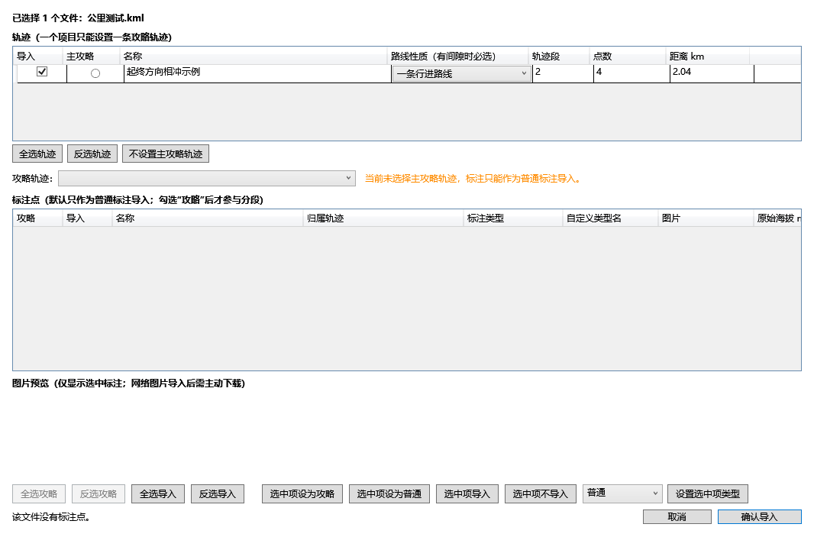

单线路线的各段按行进顺序累计，间隙按直线距离计入公里标识；落在间隙里的整公里位置沿这条虚拟直线定位。这不表示间隙有道路，也不在原轨迹添加连接线或轨迹点。公里标识包含间隙距离，因此有间隙时，它的终点总里程可能与原有不计间隙的轨迹统计不同。

**各段方向相冲：** 例如起→终＋终→起，首次显示时会弹出“设置公里标识起终方向”。逐段核对起点、终点，按需要勾选反向；第一段起点和最后一段终点成为公里计程的起终点。可定位所选段的端点，也可点击“交换整体起终点”。批量设置遇到方向相冲时，可选择逐条设置，或由程序衔接各段并随机确定整体起终方向。确认后的方向只用于公里标识，原轨迹不反转。

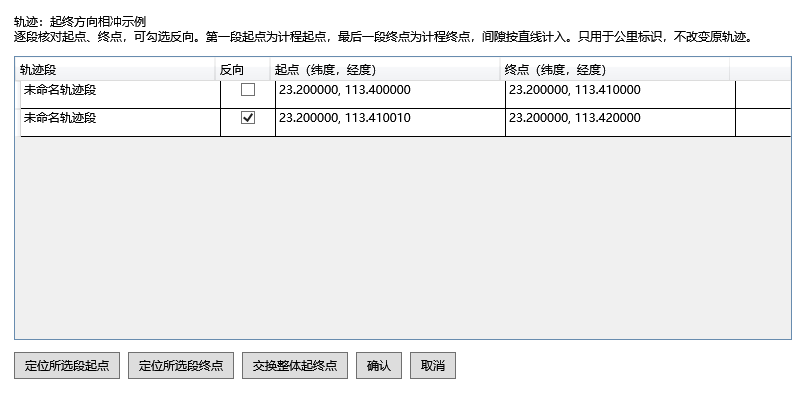

一条完整闭环轨迹沿用自身已有的起点和终点，不因两点接近而要求重选。日后要调整公里标识方向，可在轨迹属性中点击“设置公里标识起终方向…”。

2D和3D使用同一组原始轨迹计程位置。Z10起显示，缩小后密集标识会自动避让；放大可查看更完整的公里数字。长路线按当前视野控制标识资源，原始公里点和轨迹点保留。

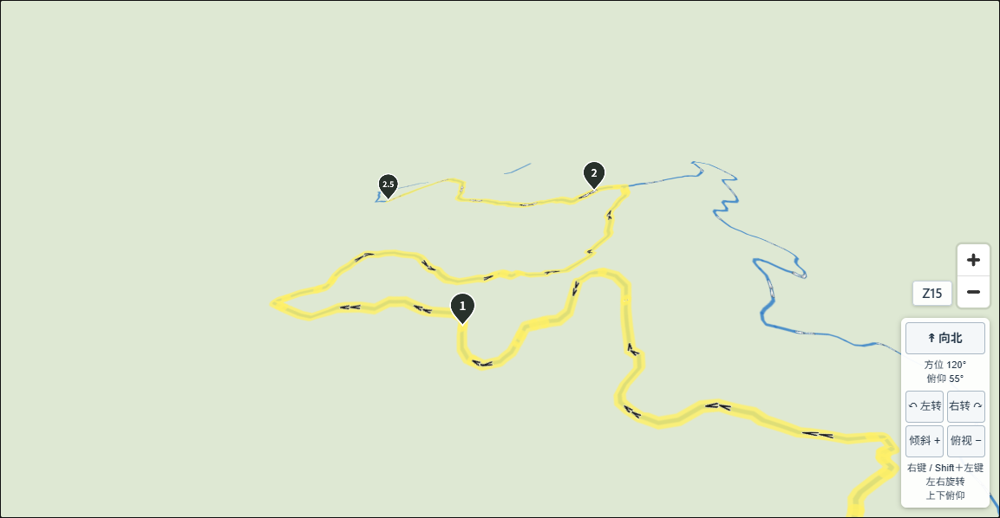

## 7. BRouter 数据管理与路线规划

### 7.1 准备 BRouter 路由数据

1. 点击“路线规划 → BRouter设置与路由数据…”。
2. 查看引擎状态、路由数据目录和已安装瓦片。
3. 选择以下一种获取方式。仅用户主动操作才下载路由数据；普通启动不会偷偷下载全部中国数据。

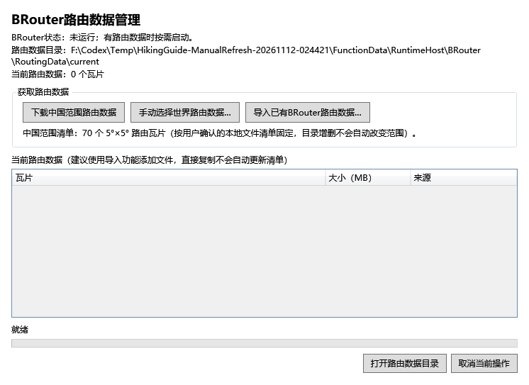

| 方式 | 操作 | 对当前数据的影响 |
| --- | --- | --- |
| 中国范围下载 | 点击“下载中国范围路由数据”，按提示确认并等待 | 使用用户确认的固定70个rd5瓦片范围，成功后替换当前数据集合；本地目录增删不自动改变中国范围 |
| 世界范围手选 | 点击“手动选择世界路由数据…”，选择瓦片后下载 | 成功后只保留这次所选集合，不与全部旧数据自动相加 |
| 导入已有文件 | 点击“导入已有BRouter路由数据…”，多选 `.rd5` | 新增到现有集合；同名需明确保留当前或用导入文件替换 |

世界窗口单击网格切换选择；“框选瓦片”后拖动矩形，Ctrl 拖动可以减选；“清空选择”重选。颜色含义以窗口底部说明为准：黄色可选、蓝色已选、紫色下载中、青色完成、红色失败、绿色当前已安装。下载前核对范围和空间，不要在误选状态下载大范围数据。

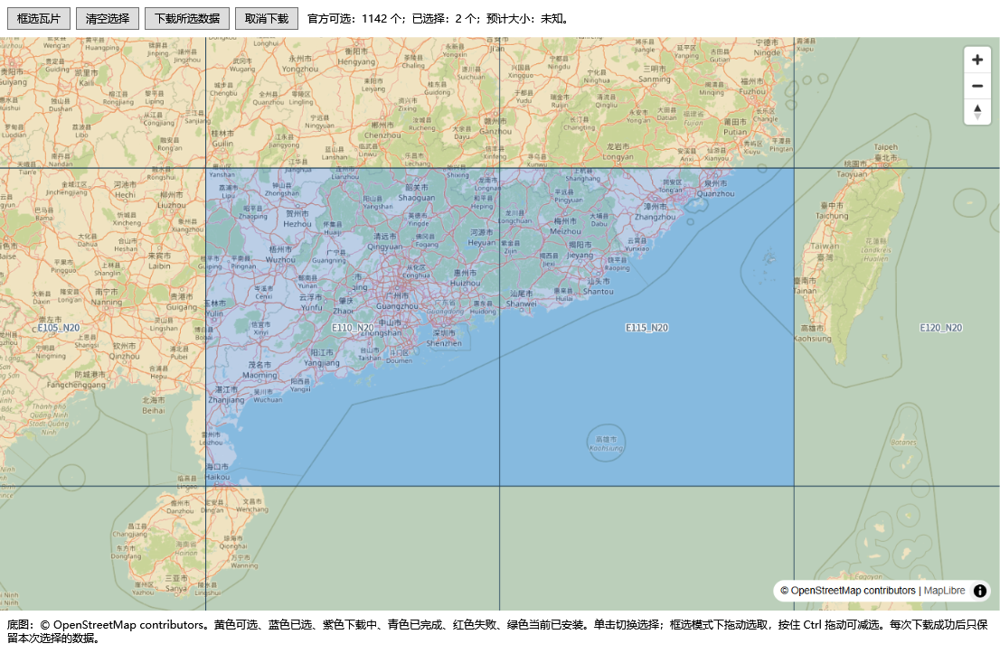

下载和导入会先暂存、校验，再切换有效数据；失败不会把半成品当成当前数据。建议使用软件导入，不直接手工复制到 current，否则清单可能未同步。世界选择窗口使用独立 OSM Germany 底图，不继承主地图两个叠加层。

### 7.2 三种规划模式

| 模式 | 线条如何生成 | 适用的操作理解 |
| --- | --- | --- |
| BRouter路由规划模式 | 在安装数据支持的道路网络上计算相邻控制点之间的路线 | 不是直线；应核对路由是否经过想走的路 |
| 手绘规划模式 | 相邻点击坐标间画直线 | 不保证该直线上有可走道路，也没有自动避障 |
| 混合规划模式 | 每一新段可选 BRouter 或手绘 | “下一段”按钮只影响下一次添加，不改已经生成的段 |

当前 BRouter 徒步最短方案使用随软件提供的 `shortest` 配置和固定路线方案，不把在线地图显示的路误当成路由数据。BRouter 返回的高程不作为攻略统计海拔；手绘也不会凭空生成 GPS 高程。

### 7.3 从开始规划到生成整条轨迹

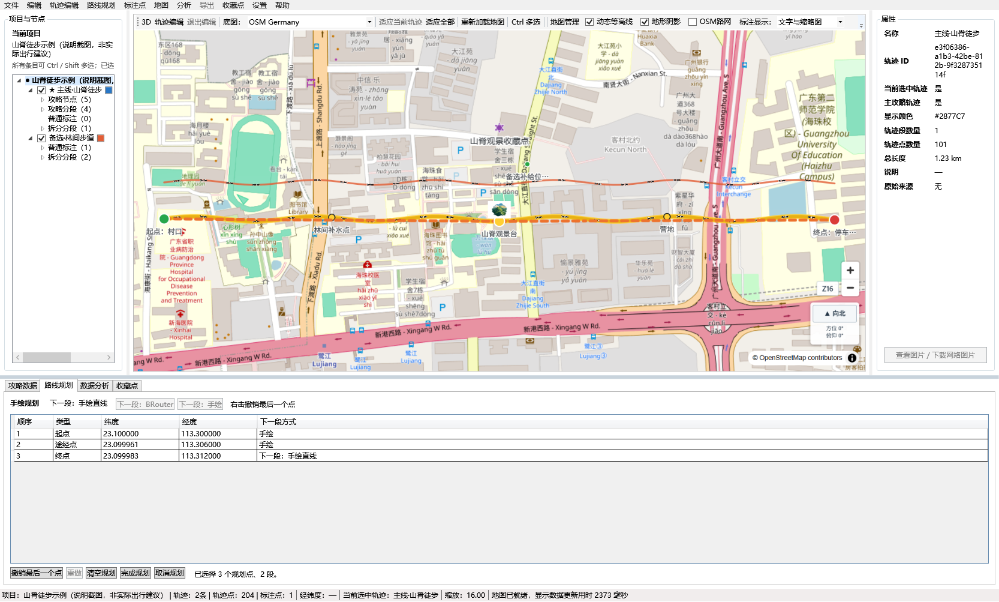

1. 先选择当前项目，将地图移到规划区域。
2. 点击“路线规划 → BRouter路由规划模式”“手绘规划模式”或“混合规划模式”。
3. 在地图点击起点，再依次点击途经点和终点。等待 BRouter 计算当前一段完成，再添加后续点。
4. 在下方“路线规划”查看点顺序、纬度、经度和下一段方式；混合规划用“下一段：BRouter”“下一段：手绘”切换。
5. 点击“撤销最后一个点”或在地图上右击一下返回一步；BRouter、手绘、混合三种模式均适用；规划栏上方也显示“右击撤销最后一个点”提示。混合模式切换下一段方式时，地图始终保持十字光标。BRouter正在计算新增点时，右击取消这个待加入的点，保留之前的规划点；计算已完成时撤销最后一个点。误撤销已完成的点可用“重做”。规划过程中右击不打开轨迹或标注菜单；3D右键拖动仍用于旋转观察。“清空规划”清掉临时会话，“取消规划”退出但不创建轨迹。
6. 核对完整预览后点击“完成规划”。
7. 在“完成路线规划”输入轨迹名称和可选说明，点击“创建普通轨迹”。
8. 创建的是一整条普通轨迹，不按每个规划控制点自动产生一组拆分分段；控制点用于规划，不自动成为攻略节点。主攻略身份仍需用户自行指定。
9. 保存项目。若要做攻略，在新轨迹上右击“设为主攻略轨迹”，再建立攻略节点，使用 DEM 分析海拔。

完成前的线是临时规划，不是已经保存的项目轨迹；不要把关闭规划前看到预览误认为已创建或已保存。缺少 rd5、无道路可路由或引擎未就绪时，先处理中文错误，不用手绘结果假冒 BRouter 结果。

## 8. 项目级轨迹编辑

### 8.1 进入、换选与退出

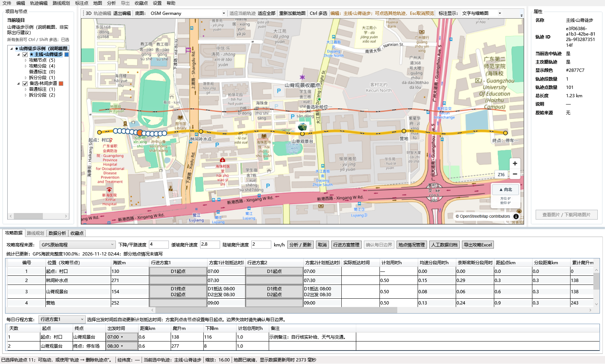

1. 打开需要编辑的当前项目，确认目标轨迹可见。
2. 点击“轨迹编辑 → 进入轨迹编辑模式”，或在项目树轨迹上右击同名操作。
3. 编辑模式作用于当前项目：进入一次后，可以在项目内换选任意轨迹，不必对每条轨迹反复重新进入。
4. 在地图靠近线条左击选定要编辑的轨迹／拆分分段；或右击线条直接打开适用编辑菜单。点击只高亮并选择对象，地图不自动飞到整条轨迹范围。
5. 缩放到需要操作的位置，点击线段出现附近真实点的拖动柄。若两条轨迹接近，先在项目树选目标或暂时隐藏另一条，再点击需要的位置。
6. 换选另一条轨迹前结束或取消当前拖动／预览。切项目时，不应继续把旧项目的未完成编辑套到新项目。
7. 结束后点击“轨迹编辑 → 退出轨迹编辑模式”，再保存项目。

### 8.2 移动、添加、删除轨迹点

1. 点击目标线条的局部位置，找到编辑柄。
2. 按住目标点拖到新位置，释放后查看软件的影响摘要与确认提示。拖动过程中只是预览，不立即覆盖项目。
3. 取消正在拖动或未完成位置选择可按 Esc。
4. 添加点：选择“添加轨迹点”，按照状态提示在目标边点击插入位置。
5. 删除点：先选定真实轨迹点，再选择“删除轨迹点”，核对影响并确认。两点轨迹段不能删成无效线，软件可能要求改为明确删除整段。
6. 误操作可以用“编辑 → 撤销／重做”或 Ctrl+Z／Ctrl+Y；文本输入框内这两个快捷键优先处理文本。

编辑点坐标后，旧来源海拔不再能代表新位置；统计会标记待更新，应重新用 DEM 分析。添加的人工点和人工连接点没有原始 GPS 海拔或时间。地图线条为性能进行的显示简化不永久删原始点，选择和编辑仍对真实几何进行。

### 8.3 拆分、删除与反转

1. 普通轨迹右击想拆分的位置，选择“拆分轨迹段”：直接在这次右击位置进行精确拾取，再显示影响确认；不用再左击一次指定位置。
2. 从顶部菜单选择“拆分轨迹段”时，仍按提示进行下一次位置点击。这两种入口的定位方式不同。
3. 主攻略轨迹及其分段不可合并、连接或新建拆分。确需这些操作时，按第4.5节先“转为普通轨迹”，所属攻略节点同步转为普通标注；编辑完成后再“设为主攻略轨迹”，所属标注同步转为攻略节点，并重新核对攻略关系。
4. 选择拆分分段后可“删除轨迹段”“反转轨迹段”；整条轨迹用“反转整条轨迹”。
5. 反转会改变方向和里程顺序，原来方向性的路况、日边界和用时应复查，不会自动把旧方向内容当成新方向结论。

拆分分段按“原轨迹名称（序号）”命名，例如轨迹“1”首次拆分后为“1（1）”“1（2）”。再次拆分已有编号分段时，保留下来的一部分保留原编号，另一部分使用新的递增编号；其他分段不重新排序命名。

删除分段不会回收它的编号。例：已有“1（1）”“1（2）”“1（3）”，删除“1（2）”后再新增分段，新编号为“1（4）”，不会补回“1（2）”。已用最大编号随项目保存，关闭项目后重新打开仍继续递增。命名不影响原始GPX/KML，既有未参与本次拆分的自定义分段名称保留。

### 8.4 合并和连接的区别

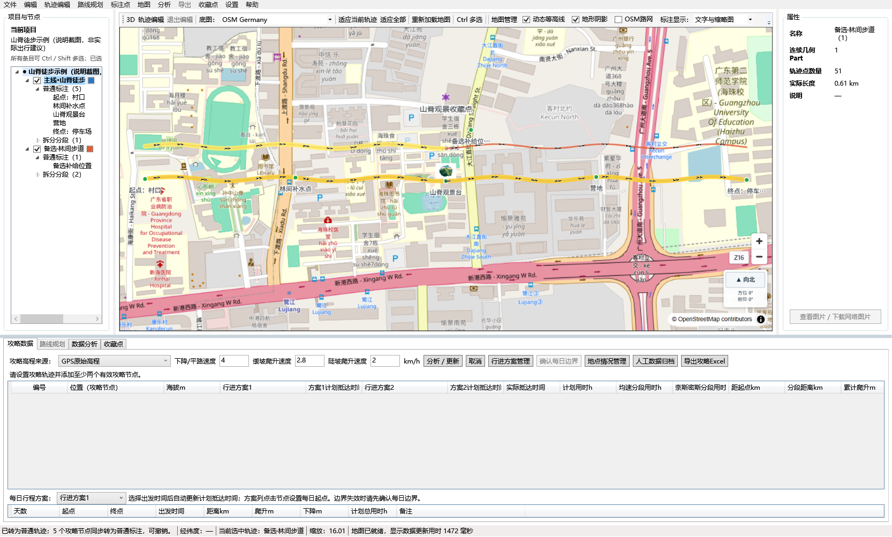

地图与项目树使用同一组选中项。在普通地图模式、轨迹编辑模式中都能多选，地图不会因点选自动适应整条轨迹。编辑模式仍只有一个当前点编辑目标；多选用于合并、连接等支持多对象的操作，不表示一次拖动修改所有轨迹。

1. 按住 **Ctrl**，在地图左击轨迹或拆分分段，逐个加选。再次 Ctrl+左击同一对象取消该项，其他选择保留。选中范围在地图同时高亮，并同步项目树。
2. 已有拆分分段的轨迹，普通点击选择所在分段。要选整条父轨迹，按住 **Alt** 左击；与 Ctrl 组合即 **Ctrl+Alt+左击**，可以把整轨加入现有选择。Ctrl 多选不会误执行当前的插点、拆分或区间工具。
3. 不按 Ctrl 点选时切换为单选。右击已经选中的轨迹或分段，会保留现有多选；右击未选项则切换到该项。项目树也可用 Ctrl／Shift 多选。整轨与它自己的拆分分段互斥，避免把同一范围重复装入新轨迹。
4. 右击选中项，选择“合并轨迹”或“连接轨迹”；也可通过顶部“轨迹编辑”菜单打开。两个窗口均支持普通整轨、普通轨迹的拆分分段以及二者混合，来源必须在当前项目内。主攻略轨迹及其分段不可参与，必须先按第4.5节转换身份。

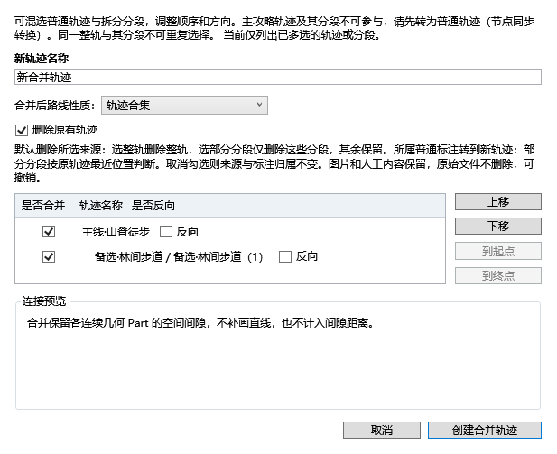

5. 输入“新轨迹名称”，核对参与项。列表中的整轨行表示完整轨迹，缩进的“轨迹名 / 分段名”表示该拆分分段。勾选至少两个不同来源；选择整轨会取消它的分段选项，选择分段会取消其整轨选项。
6. 合并时可用“上移”“下移”安排列表先后；连接时以手填编号为准，编号完整有效后上下移动可同步调整顺序（详见第8.6节）。需要逆向使用的来源勾选“反向”。用“到起点”“到终点”和预览核对接续方向。这些定位按钮是用户主动定位，与地图多选不移动视角的行为不同。
7. **“删除原有轨迹”默认勾选。** 要保留全部来源，操作前取消勾选。勾选时按所选范围处理：选中整轨就删除整轨；只选部分拆分分段就只删除这些分段，原轨迹其余分段继续保留；若选中了父轨迹全部分段，则删除该空父轨迹。不会删除磁盘上的原 GPX/KML/KMZ 文件。
8. 合并窗口中的“合并后路线性质”默认“轨迹合集”。如果各来源实际上组成一条行进路线，请主动改选“一条行进路线”；连接窗口的结果按一条行进路线记录。此选择不改变合并与连接对断口的处理，只决定后续公里标识等路线操作是否适用。然后点击“创建合并轨迹”。勾选删除时，确认窗口列出整轨删除和部分分段删除的具体范围；核对后点击“是”，才创建新普通轨迹并执行删除。取消确认不会创建或删除。新轨迹不自动成为主攻略轨迹。
9. 成果是一条新普通轨迹，所选来源合为一个逻辑分段“合并分段 1”（连接则为“连接分段 1”）；可继续右击“编辑名称与属性…”修改。普通合并保留各来源的真实物理断点，不补画连接线，不把空间间隙计入里程。一个逻辑分段可以包含多个有断点的物理几何段，不能把逻辑合并误当成道路已经连续。

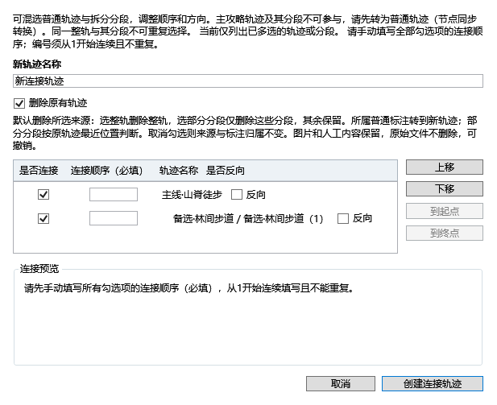

10. “连接轨迹”按连续编号决定连接顺序，反向和来源删除选项与合并相同。它会在相邻所选来源的末尾与开头之间加入“人工直线连接”，长度计入结果；确认窗口展示直线长度并提示不调用 BRouter。来源内部原有断点仍保留，不能把直线当成已核实的道路或安全徒步路线。
11. 勾选删除时，删除整轨的所属普通标注直接转到新轨迹，不再转到“未关联标注”。只删部分分段时，以标注坐标在原完整轨迹上的最近位置判断：该位置属于被移除分段则转到新轨迹，属于其余分段则仍留在原轨迹。普通标注坐标不强制吸附、不改写。攻略节点的来源轨迹引用同样随来源迁移，图片、网络链接和人工填写内容不会删除；保留分段上的有效攻略节点按新里程重建位置。取消删除勾选时，所有来源轨迹与标注归属保持不变。新轨迹及来源删除、标注转移作为同一次操作撤销。
12. 一次“撤销”同时撤销新轨迹和来源删除，恢复原几何、标注归属及主攻略引用；一次“重做”重新执行整项操作。确认结果后 Ctrl+S 保存。正式攻略统计仍需按 FathomDEM 基准更新，不因这次合并改用 GPS 或 BRouter 高程。

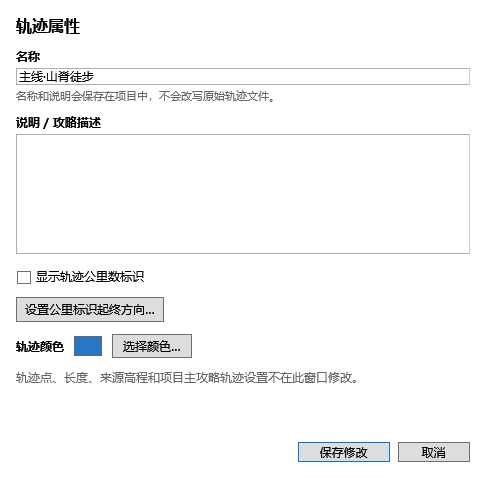

### 8.5 编辑后的关系检查

1. 检查黄色攻略节点是否仍在线上，查看失联状态。
2. 对不能可靠映射的节点，重新选定真正的轨迹位置；软件不会为了让节点看似有效而自动跳到自交路线的另一条更近线段。
3. 打开攻略数据面板，查看“历史统计／待更新”“人工数据归档”“每日边界需确认”等提示。
4. 重新分析，检查分段距离、爬升／下降及日边界，再保存。重新分析只刷新计算结果，不删除人工内容。

### 8.6 多选候选列表与连接顺序

1. 在轨迹编辑模式中，可在地图按Ctrl多选轨迹或拆分分段，再打开“合并轨迹”或“连接轨迹”。多选至少两项时，面板只列出这些所选项，不附带未选的父轨迹、子分段或其他轨迹。
2. 只选一项或未选择时，面板仍列出项目中全部可参与的普通轨迹和分段，供您继续勾选。主攻略轨迹及其分段不能参与。
3. 列表上方有标题行，标明“是否连接”或“是否合并”、“轨迹名称”、“是否反向”；连接面板另有“连接顺序（必填）”。连接轨迹时，每行勾选框后面有顺序框，进入面板时全部留空，必须由您手动填写1、2、3…连续编号。可以修改顺序，例如三行填写3、1、2，表示先连接第二行，再连接第三行，最后连接第一行。
4. 所有勾选项的编号必须恰好为从1到所选项数量的连续整数，不能留空、重复、跳号或填写小数。预览会提示编号问题；点击创建时若仍有错误，会弹出“连接顺序有误”警告并保留窗口，修正后再创建。
5. 取消勾选的项不参与连接，顺序框禁用；不会自动生成或补齐编号，已手填的编号会保留。编号尚未填完整时，“上移／下移”只调整显示位置，不自动填写编号；编号完整有效时可同步调整连接顺序。每条轨迹的“反向”仍独立生效。
6. 连接预览和最终轨迹都按编号顺序处理。“合并轨迹”没有顺序填写框，仍使用列表顺序，不在断点间补线。
## 9. DEM 数据库、高程分析和曲线联动

### 9.1 挂载 DEM

1. 点击“设置 → DEM 高程数据库…”，也可在数据分析面板点击“DEM 管理…”。
2. 点击“挂载目录…”，选择包含 TIF、TIFF 或标准 HGT 的目录。
3. 按提示填写名称及可选的单位／垂直基准信息。不确定单位时不要把未知单位强行确认成米。
4. 等待后台扫描，查看有效文件、无效文件和状态。
5. 文件增加或更新后点击“重新扫描”；目录移动或外置盘更换时用“重新定位…”保留同一数据库身份。
6. “移除挂载”移除配置和索引，不删除用户 TIF/HGT。

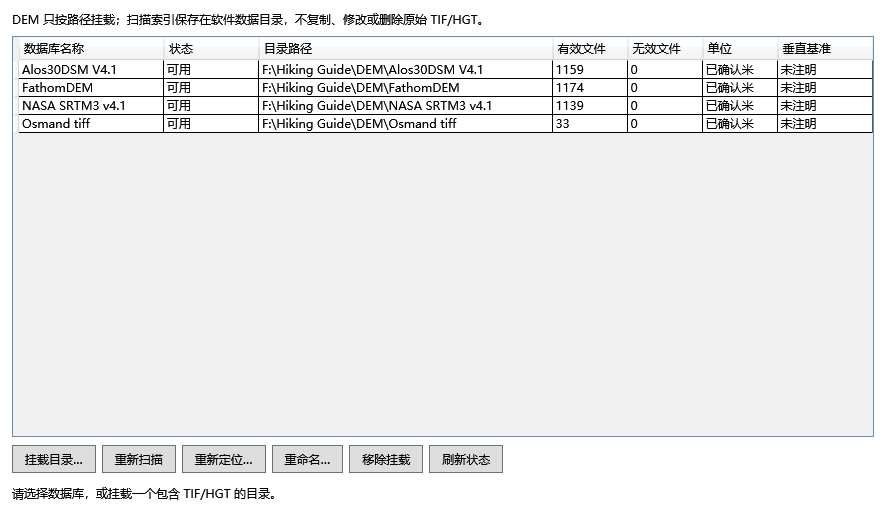

挂载不复制整套高程数据到项目。`.hikeproj` 可以保存分析结果，但重新计算仍需要对应目录可读。ALOS 等可用于对比；最终正式攻略的海拔基准仍按既定要求使用 FathomDEM，不能把 GPX、KML 或 BRouter 自带高程自动替代它。

### 9.2 选择对象、模式和来源

1. 在项目树或地图选中一条轨迹、拆分分段或有效攻略分段。
2. 切换下方“数据分析”，顶部确认当前分析对象。
3. 选择“单数据”“GPS vs DEM”或“DEM vs DEM”。
4. 单数据选择 GPS 原始海拔或某一套 DEM；GPS vs DEM 两边分别为 GPS 和选定 DEM；DEM vs DEM 选择两套不同数据库。
5. 点击“分析 / 更新”，等待后台计算；需要中止时点“取消”。来源、对象或几何变化也会触发自动更新；切换过程中不要把旧结果当成新对象结果。

GPS 模式只使用有效的原始来源海拔，缺失时不偷偷用 DEM 补齐。DEM 模式在轨迹坐标读取所选栅格，不覆盖 GPS 来源。NoData 不当作海拔 0；跨断点和缺测不插值出不存在的山坡。BRouter／手绘新轨迹没有来源海拔时，GPS 不可用是正常现象，应选择 DEM。

### 9.3 指标解释

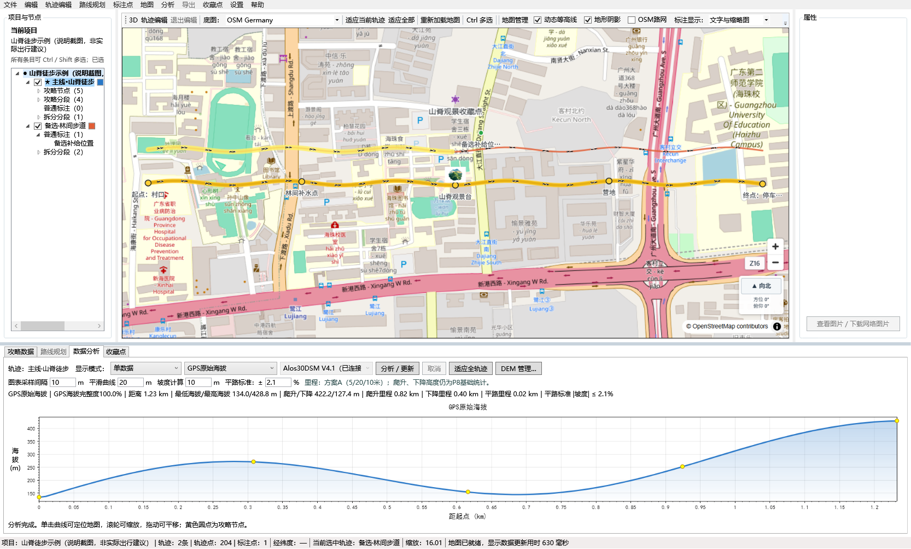

| 显示项 | 含义 |
| --- | --- |
| 完整率／覆盖率 | 所选高程来源在本次分析对象上有效数据的比例；100% 才表示全程完整 |
| 距离 | 完整计算轨迹的水平链程长度；不计段间不存在的直线 |
| 最低／最高 | 所选来源有效分析数据的最低、最高海拔，不是爬升之和 |
| 爬升／下降 | 沿线路累计的上升高度与下降高度，单位米；不是终点与起点的单次高差 |
| 爬升／下降／平路里程 | 按局部坡度把水平长度分类后的结果，单位 km；与累计爬升高度是不同量 |
| 横轴“距起点” | 当前分析对象沿线里程，不是地图直线距离 |
| 纵轴海拔 | 当前高程来源对应的分析海拔，单位米 |
| 悬停坡度 | 局部窗口内高差／水平距离的百分比；正为上坡、负为下坡 |

缺测时保留有效曲线和覆盖提示，不应把部分覆盖统计当全程数据。双源曲线差异可能来自分辨率、垂直基准、位置误差或来源本身，不代表软件已经自动确定哪套更准确。

### 9.4 必须分清的两套参数

| 参数范围 | 默认／当前采用值 | 用途 |
| --- | --- | --- |
| 图表与基础高度分析 | 采样10米、平滑20米、坡度窗口10米 | 显示分析曲线和既有高程基础统计；界面可修改 |
| 里程分类方案 A | 采样5米、居中平滑20米、局部坡度窗口10米 | 爬升路段、下降路段和平路的距离分类；不是随便拿图表采样替代 |
| 平路标准 | 默认 ±2.1%，面板可改并全局记录 | 坡度处于 `[-2.1%, +2.1%]`，包括两端边界，为平路 |
| 缓坡／陡坡界限 | 35% | 已属于爬升的路段中，坡度 <35% 为缓坡，≥35% 为陡坡 |

默认分类：坡度严格 >+2.1% 为爬升，严格 <-2.1% 为下降，两个边界仍归平路；上坡中 `(2.1%,35%)` 为缓坡，`≥35%` 为陡坡。这里的 35% 是坡度百分比，不是 35 度角。缺测区间为未分类，不挤入平路。

方案 A 使用水平链程，以局部窗口求坡度，连续段边界按实际范围截短，尾段不足5米按真实长度处理。修改平路阈值会后台重分类，不重读整套 DEM、不自动缩放曲线。曲线显示参数和距离分类参数不要混写。

“Locus兼容模式”的里程分类与累计爬升、下降高度采用不同计算步骤。高度累计使用基础统计，不保证与Locus内部算法完全相同。对比时必须使用相同轨迹、同一 DEM、同参数及同区间，不能把不同来源的误差全部归为软件错误。

### 9.5 曲线操作与地图定位

1. 在曲线上移动鼠标，查看位置、里程、坡度等悬停信息；地图会显示对应位置的联动提示。
2. 在曲线上左击一点，地图移动到沿线路对应位置，便于核对路段。
3. 黄色圆点表示有效攻略节点在曲线上的位置，不显示节点名称；点只作位置提示，不改节点坐标。
4. 滚轮缩放横轴范围；拖动曲线水平平移。双图模式两侧里程视窗联动，便于按相同区间比较。
5. 点击分析面板“适应全轨迹”恢复完整剖面范围。该按钮用于曲线范围，不等于要求每次地图轨迹点选都适应整条路线。

## 10. 跨项目收藏点

### 10.1 找点、选点和查看

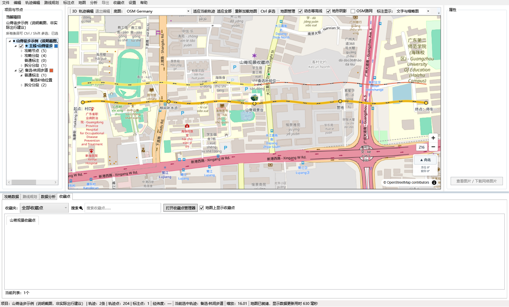

1. 点击下方“收藏点”，在“收藏夹：”下拉框选择一夹，或选择全部收藏点。
2. 在“搜索🔍”输入名称或描述中的文字。非空搜索查整个收藏库，不限当前夹；清空搜索恢复当前夹筛选。
3. 点击名称卡片，地图定位并将唯一当前主选显示为金色星形，其他点仍紫色。
4. 鼠标指中卡片显示说明、海拔、坐标、首张缩略图和图片数量；离开、滚动或切换列表自动关闭。
5. 在地图指中收藏星形显示信息牌。右击收藏点可以编辑、移到收藏夹、查看图片、删除或查询天气。
6. 取消“地图上显示收藏点”只隐藏图层，不删除数据库；右键“取消收藏点选中”清除主选。

收藏名称在地图上显示，可能互相重叠；这是保留名称的显示策略，不表示位置已改变。收藏的选中状态独立于项目轨迹选择，切项目或关闭全部项目仍可以使用收藏库。

### 10.2 新建、复制、编辑和拖动

1. 地图目标位置右击“添加收藏点”，或用“收藏点 → 新建收藏点…”。
2. 填写名称、描述、坐标和所属收藏夹。新建窗口默认选中高程列表第一套已挂载DEM，后台读取当前位置海拔并填入；也可以自行换选其他DEM，选择后自动读取，无须再点击读取按钮。
3. 海拔仍可留空或人工填写。没有DEM、未覆盖或读取失败时保留当前填写值，并显示提示，不填成0；快速切换数据库时只采用最后一次选择的结果。编辑已保存的收藏点时先保留其固定海拔，主动换选DEM或更改坐标才重新读取。
4. 在项目普通标注／攻略节点右击“复制为收藏点”，生成独立记录，原点不删除、不改写。攻略节点复制可核对使用当前吸附位置或原始位置。
5. 拖动地图收藏星形到新位置，释放后后台更新坐标与海拔。移动不是项目轨迹编辑，不改变项目线条。
6. 没有有效 DEM 时，新坐标仍可保存，但旧海拔清空为无数据，不能把原位置海拔带到新位置。Esc、失焦或移出地图取消正在进行的拖动。

普通已保存的收藏海拔是固定记录，切换地图或数据分析使用的DEM不会自动修改它；在该收藏点编辑窗口主动换选DEM时才会自动读取。拖动时按现有移动规则重新读取可用DEM。收藏海拔不替代FathomDEM最终攻略统计基准。

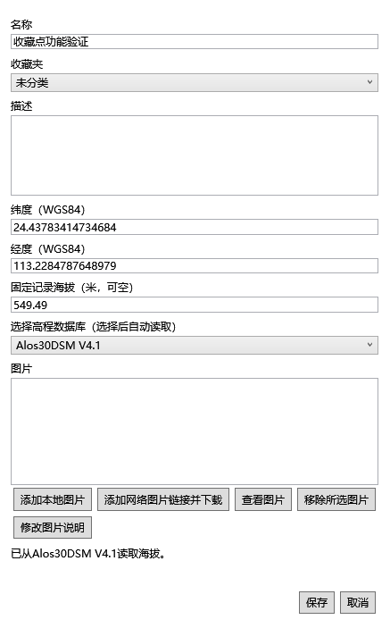

**收藏点图片**

1. 点击“添加本地图片”，可一次选择多张图片。
2. 点击“添加网络图片链接并下载”，粘贴HTTP／HTTPS图片链接并确定，软件自动下载、校验并加入图片列表。下载完成后点击“保存”，图片原文件随该收藏点存入收藏库，之后可离线查看。同一链接已有本地图片时直接选中该图片；仅有网络引用时，下载后改为本地图片。下载失败不会添加空图片。
3. 选中图片后点击“查看图片”，或直接双击图片列表中的一项，打开统一查看器。已有的网络引用也可双击下载并查看；仅查看时使用缓存，不自动改写收藏点。
4. 在查看器中点击“放大”“缩小”，或滚动鼠标滚轮调整大小；放大后按住图片拖动查看其他部分。点击“左转90°”“右转90°”旋转，点击“适应窗口”或双击图片恢复合适大小。“上一张”“下一张”和图片下拉框可切换图片。这些操作只改变观看方式，不修改原图。
5. 需要将当前图片单独保存到电脑时，点击查看器的“另存为…”，在保存类型中选择JPG或PNG，并指定新文件名。旋转和缩放属于观看操作，不覆盖收藏库中的原图。
6. 在编辑窗口使用“移除所选图片”取消本次收藏点的图片关联，使用“修改图片说明”填写说明，最后点击“保存”。取消编辑不会提交图片或文字改动。

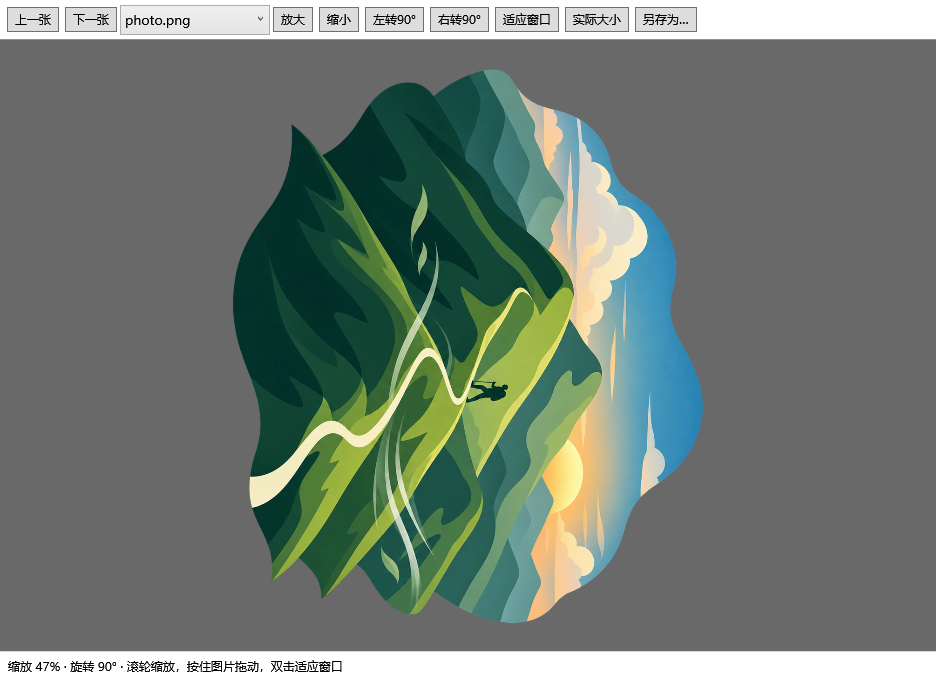

### 10.3 管理、交换和备份

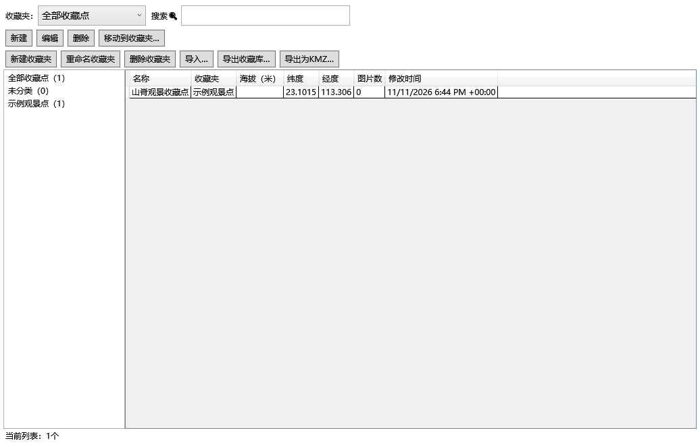

1. 点击“打开收藏点管理器”，或用顶部“收藏点 → 收藏点管理器…”。
2. 使用“新建收藏夹”“重命名收藏夹”“删除收藏夹”；系统“未分类”不可删除或改名。
3. 删除普通夹时核对“点移到未分类”或“删除夹内点”的区别，后一种需要额外确认。
4. 在列表用Ctrl／Shift多选，可移动、删除或导出所选点；“编辑”打开当前一项。地图主选的金色仅指一个主选点，不否定列表的多选范围。
5. 点击“导出收藏库…”打开范围选择窗口。可选择“全部收藏库”，也可在“多选收藏夹”勾选多个夹，或在“多选收藏点”跨夹勾选多个点。搜索用于查找列表项，“全选当前列表”“清空当前列表”作用于当前筛选结果；隐藏在其他搜索结果中的已勾选项仍会保留，导出前核对下方勾选数量。
6. 点击“继续导出”后选择保存位置，生成包含数据库记录与原图的 `.hgfav`，适合备份和跨设备迁移。单独导出一个收藏点或一个收藏夹时，默认文件名采用该点或该夹名称，可在保存窗口自行修改；Windows不支持的文件名字符会替换为下划线。
7. “导出为KMZ…”使用同一范围选择窗口，用于第三方地图查看点、说明与本地图片；仅网络引用仍保留链接，不保证第三方软件离线可看。KMZ不代替完整收藏数据库备份。
8. 点击“导入…”可选择 `.hgfav` 或 `.kmz`。KMZ只导入兴趣点及内嵌图片、网络图片引用，不把轨迹线当作收藏点；按原收藏夹信息或文件夹名称分组，没有分组时使用文件名建夹。网络引用不会在导入时批量下载，可在编辑窗口按需查看或添加下载。
9. 对同身份冲突明确选择“跳过”“覆盖”或“保留两份”。没有稳定收藏点身份的第三方KMZ通常作为新点导入。导入失败时原库保留，原KMZ和交换包不修改。

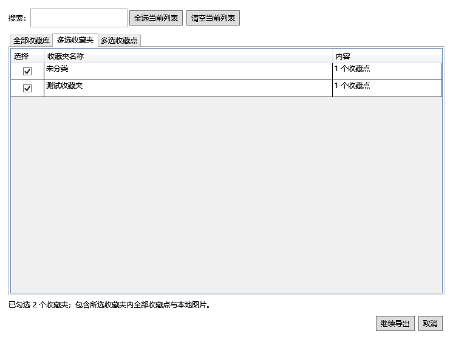

收藏库独立于 `.hikeproj`。仅保存项目不等于备份收藏点。目录级备份应先关闭软件，再备份完整 Favorites 目录和原图；软件运行时不要仅拷贝一个 SQLite 文件遗漏正在写入的数据或原图。

## 11. 攻略数据工作台：从自动统计到人工攻略

### 11.1 建立可计算的攻略

1. 选择一个项目，并设置唯一主攻略轨迹。
2. 至少准备两个有效攻略节点，分别覆盖想作为起终点的范围；实际攻略按有效节点里程排列。
3. 点击下方“攻略数据”。若提示“请设置攻略轨迹并添加至少两个有效攻略节点”，先完成上面两项，不在空表里硬填。
4. 在“攻略高程来源”选择所需来源。它与“数据分析”页的来源选择独立；做正式最终攻略时确认选的是 FathomDEM 对应数据库。
5. 点击“分析 / 更新”，等待统计完成，查看第二行的覆盖率、计算时间和待确认提示。

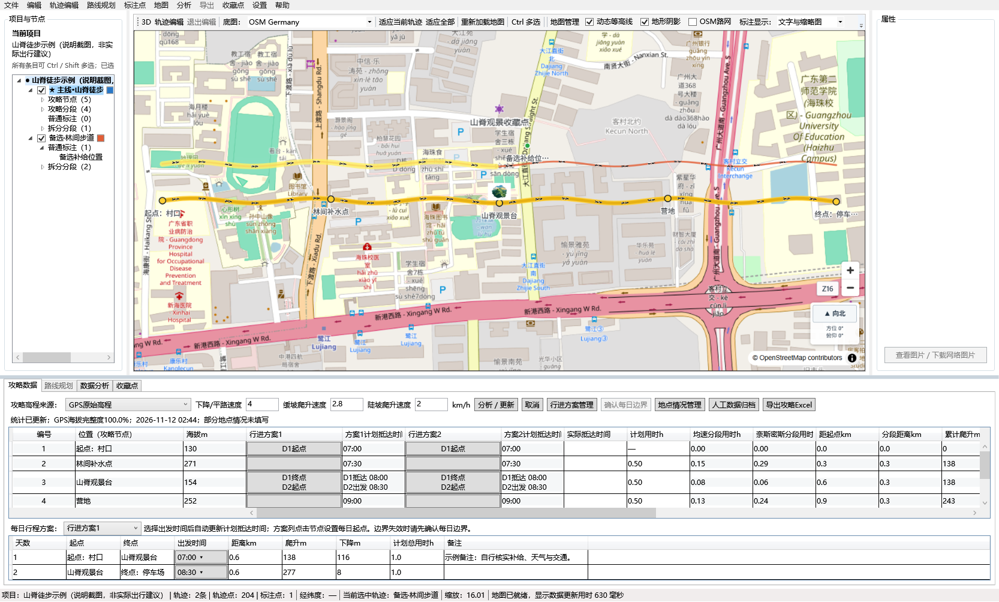

### 11.2 三项速度和两种参考时间

1. 填“下降/平路速度”“缓坡爬升速度”“陡坡爬升速度”，单位 km/h，数值必须 >0。
2. 新项目速度默认空白，不照抄 Excel 模板样例；留空时均速用时不计算。
3. 均速分段用时先将下降与平路、缓坡、陡坡各自距离除以对应速度，再乘 `65/60` 加入比例休息。例子：先算出纯移动1小时，均速参考结果约为1.08小时。
4. 奈斯密斯分段用时是另一独立参考：`分段距离km ÷ 5 + 分段爬升m ÷ 600`，不使用三项个人速度，不额外添加休息或下降惩罚。
5. 两种参考值均不会自动写入“计划用时h”。要形成每日计划和抵达时间，必须自己输入人工计划用时。

这些是时间模型的定义，不是对个人体能或野外风险的保证。高程覆盖不完整时，相关参考值可能留空，不应把空白当0。

### 11.3 每列代表什么

通常每一行代表一个攻略节点，从第二行开始，分段字段代表“前一节点 → 当前节点”的入站分段。首行没有上一段，因此计划分段用时等不能按普通段填写；首行“分段路况”仍可以编辑，记录起点情况。

| 列／列组 | 含义与操作 |
| --- | --- |
| 编号、位置（攻略节点） | 当前有效节点顺序和名称；选择行可定位地图，改名到节点／属性编辑处操作 |
| 海拔m | 当前攻略高程来源在节点位置的海拔；只读 |
| 行进方案1、2… | 点击中间节点设置／取消该方案的每日起点；格内只显示起终点标签 |
| 方案计划抵达时间 | 按该方案每日出发和人工计划分段用时累计；共享节点可显示前日抵达和次日出发两行 |
| 实际抵达时间 | 用户实际记录，格式 HH:mm，不反向改写规划时间 |
| 计划用时h | 前一节点到本节点的人工计划小时数；可以留空或填0，不能负数 |
| 均速分段用时h | 按三项速度、坡度分类与比例休息计算的参考值；只读 |
| 奈斯密斯分段用时 | 按标准距离／爬升公式计算的参考值；只读 |
| 距起点km、分段距离km | 沿主攻略轨迹累计距离，以及上一攻略节点到当前节点距离 |
| 累计／分段爬升m、下降m | 当前节点之前累计高度，以及入站攻略分段高度变化的累计量 |
| 分段爬升距离km、分段下降距离km、平路距离km | 对入站分段的坡度里程分类，不是海拔高差 |
| 分段路况 | 人工多行文字；首行也可填；双击打开完整路况窗口 |
| 营地、下撤、补给、补生水、洗手间等地点情况 | 当前启用的地点字段；使用留空、✔、不确定、✘四态，不把未知当没有 |

地点字段按项目自定义，表格不一定同时显示示例里的所有列。用“地点情况管理”添加／恢复、改名、上下移动或移除。移除只是隐藏定义，已填值保留；恢复同一字段可继续使用。

### 11.4 输入、键盘移动和显示精度

1. 点击可编辑格或双击进入输入。
2. Enter、Tab 或离开单元格提交输入；方向键可移动到相邻单元格，移动到可编辑位置即可继续输入。
3. 地点下拉展开时，方向键优先用于选择下拉选项；不要以为正在移动表格。
4. 路况长文本双击打开“编辑完整分段路况”，输入多行后点“保存路况”。
5. 选中行使用蓝色边框提示，文字保持可见；编号横向居中，表内文字垂直居中。
6. 冻结编号、位置、海拔前三列，其他列用水平滚动查看。列宽拖动或双击自适配均全局保存。

攻略显示及导出精度：海拔、累计／分段爬升下降按四舍五入到整数米；距起点、分段距离、上下坡里程及平路里程保留1位小数km；其他通常小时值保留2位小数。每天汇总距离、计划总用时保留1位小数，爬升下降为整数。只改变显示位数，不把舍入后的值写回计算精度。

输入和重分析都是后台安全保存的一部分，但完成重要工作后仍主动保存项目。统计为灰底只读字段，不能通过改显示数字来修轨迹或高程来源。

## 12. 多方案与每日行程、出发时间和抵达时间

### 12.1 管理多个方案

1. 点击“行进方案管理”。
2. 新项目默认两套独立方案；可“增加方案”，也可调整“上移／下移”。
3. 删除方案需要确认，至少保留一套。删除该方案会删除其每日边界与出发时间，不代表删除轨迹或其他方案。
4. 不同方案拥有各自的日边界和每日出发时间；人工分段计划用时则由各方案共享，不是每套各填一份。

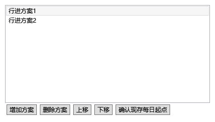

### 12.2 点选每天的边界

1. 在上表目标“行进方案N”列找到希望第二天出发的攻略节点，点击该格。
2. 该节点成为“D1终点 / D2起点”；再选后续节点，形成后续天数。
3. 再点击已有中间起点可取消该日边界。
4. 第一节点固定为D1起点，最后节点只作最后一天终点，不能在最后节点另开空的一天。
5. 格内只显示起终点文字。将鼠标停在已设置边界的格上，悬浮框显示该日距离、爬升、下降和计划总用时，离开自动隐藏；已设置格不再显示“点击设置…”提示。

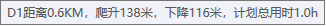

### 12.3 用时间选择器填写每日出发

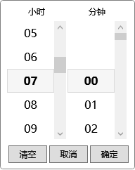

1. 在下方“每日行程方案：”选择要编辑的方案，确认不是另一套方案。
2. 在该天“出发时间”点击“选择时间 ▾”或已有时间。
3. 在弹出选择器选择小时和分钟，点击“确定”，格式为 HH:mm，不选择秒。
4. “取消”保留原时间；“清空”将该日出发设为未填写，不把它变成00:00。
5. 上方该天起点显示出发时间，此后按人工“计划用时h”累加得到节点计划抵达。
6. 共享边界的计划时间格分两行，例如“D1抵达 18:00”“D2出发 07:00”，既保留前一天抵达，也显示新一天独立出发。
7. 在每日表“备注”填写该天说明，可以多行，不设固定字节长度。对应方案和天的备注分别保存。

每日表的距离km保留1位小数，爬升m／下降m为整数，计划总用时h保留1位小数；各列也可拖动／双击自适配并全局保存。

### 12.4 为什么计划抵达仍是空白

按照以下次序排查，不要重复改日期或用自动参考时间覆盖人工输入：

1. 是否在下方选择了与上方抵达列一致的方案？另一套的时间不互相复制。
2. 该天是否真的点“确定”提交出发，而不是只在弹窗中滚动？
3. 从该日起点到目标节点之前，每个入站分段的“计划用时h”是否都已填写？某段为空时，本日该段及之后抵达留空；人工填0才代表有效0小时。
4. 第二行是否提示“部分方案每日边界失效／需要重新确认”？曾经删除、反转或替换节点可能使旧边界失效，模型会暂停该方案抵达计算，不擅自猜替代点。
5. 若边界失效，在“每日行程方案”选该方案，点“确认每日边界”；或在“行进方案管理”点“确认现存每日起点”。
6. 阅读列出的 D1、D2… 起终点，确认是希望沿用的行程再确认。操作只移除失效引用并沿用现存边界，保留现有出发、用时和备注；若边界不对，先重设正确起点。
7. 等待刷新，核对并保存项目。

跨午夜的时间可能显示到次日 HH:mm；内部保留跨日偏移，不代表回到同一天。下一天从自己的出发时间独立计算，不接着上一天的夜间抵达继续累加。

## 13. 轨迹、标注、图片与攻略 Excel 导出

### 13.1 根据用途选择格式

| 格式 | 用途 | 图片与项目关系 |
| --- | --- | --- |
| `.hikeproj` | 继续编辑的完整项目 | 保存项目轨迹、节点、人工内容和已内嵌图片；不代替全局收藏库备份 |
| GPX | 与轨迹设备／软件交换轨迹和支持的点属性 | 不内嵌项目图片原图，第三方可能忽略扩展信息 |
| KML | 地图软件查看轨迹、标注及描述 | 可保留图片链接／描述，不携带项目图片原图；不要把外部链接当离线图片 |
| KMZ | 携带轨迹、标注及项目内图片的地图交换包 | 打包 `doc.kml` 与所选标注已保存的原图；在线图保留链接，不自动下载 |
| `.hgfav` | 完整收藏库备份／交换 | 独立收藏数据库与原图，不是项目轨迹备份 |
| `.xlsx` | 对外发放最终攻略表 | 静态导出结果；不能导回成为完整可编辑项目 |

### 13.2 单轨、分段及合并导出

**名称兼容规则：** 单独导出一条轨迹，或在“合并导出”只选一条时，GPX顶层metadata名称、KML／KMZ文档名称及轨迹名称统一使用该轨迹的名称，默认文件名也使用轨迹名，不使用项目名。导出拆分分段时使用该分段名。合并导出选多条时，顶层名称为所选轨迹名称组合，各条轨迹各自保留名称；默认文件名使用第一条名称加“等N条轨迹”，避免名称过长。项目名和轨迹名不被修改。部分APP只显示顶层文件标题；一份多轨文件只有一个顶层名称，如需每个文件都以独立轨迹名显示，请分别导出。旧文件需重新导出后再导入APP。

**连接成果的单段兼容导出：** 通过“连接轨迹”生成的成果，导出GPX时使用一个`trk`内的一个`trkseg`，导出KML／KMZ时使用一个`LineString`，不再把来源物理分段分别写入文件。全部点按现有顺序串联，边界重复点、连接点和可导出海拔／时间信息保留，不删点。此规则仅改变导出视图，不重写项目内部轨迹结构或攻略统计；导出单线在内部断点处会按相邻点直线表达，因此第三方重新计算的距离可能包含这些间隔，不代表已核实道路。普通“合并”及普通多段轨迹仍保留断点。需要使用新的导出设置时，请重新导出并在目标APP重新导入。

1. 选中项目树中目标轨迹或拆分分段，右击“导出GPX”“导出KML”或“导出KMZ”。
2. 核对当前对象和输出路径，选与原始输入不同的新文件名，避免自行覆盖唯一原文件。
3. 需要明确选择多条轨迹／多个标注时，使用“文件 → 合并导出…”。
4. 在合并导出窗口选格式，勾选要导出的轨迹，以及普通标注和攻略节点；核对“所属轨迹”“项目图片”“网络图片”数量。
5. 点击“选择文件并导出”，等待完成。
6. “合并导出”只把所选对象装到同一交换文件，不等于在项目里用直线连接多条轨迹。

完整 KMZ 应包含所选标注的本地原图和链接，不仅是把 KML 改个 `.kmz` 扩展名。需要离线图片时先主动下载并保存项目，再导出 KMZ；未下载的网络图片仍依赖网络。导出后请在目标APP核对轨迹名称、标注描述与图片，确认文件满足您的使用需求。

### 13.3 最终攻略 Excel 导出

1. 回到“攻略数据”，核对唯一主线、有效节点、FathomDEM 来源和统计是否为当前最新。
2. 检查三项速度、人工计划用时、每日边界、出发时间、地点情况和路况。人工未填的值不会自动用0或参考时间补齐。
3. 点击“导出攻略Excel”。
4. 若出现缺失、历史统计或待确认警告，先阅读；可以返回修正，或明确确认按带警告的当前结果继续导出。
5. 选择新的 `.xlsx` 路径，不能把软件模板本身作为导出目标。
6. 等待后台输出与重新打开校验完成，再用 Excel 或兼容软件查看文件。

输出特点：

- 数值显示精度与界面一致；内部统计仍保持原精度。
- 每套“行进方案”列只导出各天总结，不导出每天“起点／终点”标签，文字左对齐。
- 计划抵达列保存时间信息，与人工计划用时／每日出发逻辑一致。
- 每日备注从工作簿“备注：”下一行开始逐行排列，带方案和天数身份，避免备注与日对应关系丢失。
- 启用的地点字段和方案数量动态输出；不把旧模板样例值作为新项目参数。
- 软件不修改原模板；表内长路况超过 Excel 单格容量时通过连续“路况续”列保存并提示，不静默截断。

界面列宽只是用户界面设置，不自动覆盖模板的导出列宽。Excel／WPS对自动换行和行高显示可能有差异，发送前实际查看导出文件；导出成功不是对任意第三方软件视觉显示的保证。

## 14. 查询地图位置天气

1. 将地图移到目标位置，在要查询的准确位置右击。
2. 选择“windy天气”或“meteoblue天气”。轨迹、标注或收藏点右键也可提供同样入口。
3. 软件将这次右击的 WGS84 经纬度交给系统默认浏览器，打开相应网站。
4. 在网站内核对位置、日期、时区、模型和海拔；本软件不缓存天气预测，也不自动写入攻略。

按钮只是按坐标打开第三方页面，网络与浏览器不可用时可能失败；地图上的一点不代表整个高山线路的天气。不要把截图中的演示天气当成实际出发日预报。

## 15. 数据安全、备份和异常恢复

### 15.1 建议保存哪些内容

1. 项目：保存 `.hikeproj`，重要版本可“另存为”不同日期／版本副本，并保留 `.bak`。
2. 原始来源：保留原 GPX、KML、KMZ，软件不自动覆盖它们；导出另存新名称。
3. 收藏库：用 `.hgfav` 导出全部，或退出软件后备份完整 Favorites 目录。
4. 全局设置：退出软件后备份当前用户的 `settings.json`；其中可能含私密请求头，不公开分享。
5. DEM：自行备份实际 TIF/HGT 目录；项目只保存路径和分析快照。
6. BRouter：需要保留时备份 RoutingData 与对应清单；不要只复制 JAR 以为路由数据也在其中。
7. 软件模板：保留随软件分发的模板，不用人工数据覆盖它。

**便携程序和安装程序要分别备份：**

| 内容 | 便携程序（例如F盘现用目录） | 安装程序 |
| --- | --- | --- |
| 布局、列宽、图源、最近项目、DEM挂载、恢复记录及缓存 | 程序目录中的`Data` | 当前个人数据目录中的相应数据文件及子目录 |
| 收藏库与收藏原图 | 程序目录中的`Favorites` | 当前个人数据目录中的`Favorites` |
| BRouter路由数据、离线地图 | 程序目录中的`BRouter`、`离线地图` | 当前个人数据目录中的相应文件夹 |
| 操作说明及配图 | 程序目录中的`docs` | 程序安装目录中的`docs` |

安装程序的个人数据目录随安装盘变化，详见第18.2节。备份时先关闭软件，保留完整目录结构；不能只复制EXE或单个SQLite文件。图源配置可能含密钥或私人请求头，不要直接公开备份。

项目文件与实际DEM文件不会因备份设置而自动收进备份。应另行备份所选项目和DEM目录；换盘符或换电脑后重新指定路径。Windows 10/11便携程序还需要对应的.NET桌面运行时和WebView2；安装程序按安装器提示准备环境。便携程序的数据目录必须可写，安装到Program Files的程序则使用分离的个人数据目录。

### 15.2 安全操作习惯

1. 进行大范围反转、删除、连接前先保存或另存项目副本。
2. 阅读依赖／影响确认，尤其是主攻略轨迹、节点和人工分段变化。
3. 后台保存、导出或下载尚未结束时，不强制结束进程、不拔掉保存盘。
4. 原图下载和分析失败时先看中文原因，不清空项目或把缺测填0。
5. 外置 DEM 断开时可查看历史快照，但“历史／待更新”结果不冒充当前结果；重新定位后分析。
6. 不在运行中手改 JSON、SQLite 或项目 ZIP；需要恢复先关闭软件、备份现有文件再处理。

## 16. 常见问题速查

| 现象 | 先检查与操作 |
| --- | --- |
| 软件有界面但地图空白 | 网络、图源缩放范围、服务器测试结果；换有效底图，必要时重新加载地图；不要删除项目 |
| 地图有路，BRouter却不能规划 | 在线底图与rd5是两套数据；检查当前数据瓦片覆盖和引擎状态 |
| 手绘线穿过悬崖、河流或无路区域 | 手绘只画直线，没有道路可行性判断；自行核对实际路线，不能当路由结果 |
| 新规划轨迹GPS高程空白 | 没有原始GPS高程；使用所需DEM分析，最终攻略选FathomDEM |
| 图片下载按钮无效／变灰 | 项目或目标点状态、图片是否已经内嵌、外部URL是否有效；读取状态提示，不要重复保存空图片 |
| KMZ在第三方只有链接没有离线图 | 未下载的在线图不自动打包；先下载、保存项目，再重新导出KMZ |
| 普通标注出现在未关联标注 | 来源没有可靠归属或原轨迹删除；在标注编辑指定轨迹，或吸附到最近轨迹 |
| 节点吸附到另一圈折返线 | 用手动“选择轨迹位置”指定正确经过，不仅看哪个点几何更近 |
| 节点变灰／攻略分段减少 | 轨迹编辑或主线变化导致失联；检查位置关系，人工内容保留在原对象／归档 |
| 计划抵达空白 | 本说明12.4：核对方案、出发已确定、每段人工用时、每日边界是否失效 |
| 填了三项速度仍没有计划抵达 | 速度只算参考用时，不自动填人工计划用时 |
| 分析结果与Locus不完全一样 | 确认来源、范围和参数；当前高度累计未宣称完整复刻Locus |
| 图表采样写10米但分类提示5米 | 正常：图表／基础高度和里程分类两套参数，本说明9.4有区别 |
| 切项目后地图图源没有跟着变 | 正常：三层地图是软件全局，不是每项目的独立图源 |
| 选轨迹后地图不自动显示全轨 | 地图线条点选保持视角；需要全轨主动用适应按钮 |
| 重启后少了一个项目 | 手动关闭的项目不自动恢复；用最近项目或打开项目重新加载 |
| 仅保存项目，收藏点在另一台电脑消失 | 收藏库独立，需要导出／导入hgfav，不在项目包里 |
| 调了界面列宽，Excel列宽没变化 | 正常：界面全局列宽与Excel模板导出布局是不同设置 |
| 看不到文字或缩略图 | 在“标注点 → 显示方式”选择模式；文字从Z12、缩略图从Z14显示，重叠时会避让；没有有效图片时显示圆点 |
| 没有公里标识设置入口 | 轨迹合集不提供此入口；核对属性中的路线性质。旧多段轨迹大断口需要先明确为一条行进路线 |
| 终点公里数字与轨迹统计不同 | 有间隙的路线，公里标识包含段间直线距离；原轨迹统计仍按原定义，不计未连接的间隙 |
| 有离线地图却仍在联网 | 检查离线包是否启用、来源是否匹配、当前地点与层级是否在包内；超过最高下载层级仍从在线图源获取清晰瓦片 |

## 17. 给新用户的一次完整练习

以下仅练习软件流程，不是实际出行规划建议。

1. 新建“操作练习”项目，保存到自己的练习目录。
2. 导入一份有轨迹和几个标注的GPX/KML/KMZ。主攻略默认不选择，请手动指定唯一主线；有间隙时同时确认“一条行进路线”或“轨迹合集”。
3. 保留参考点为普通标注，把起点、中间点、终点设置为攻略节点。
4. 检查每个节点的吸附位置和排序；自交位置用手动选择纠正。
5. 在“标注点 → 显示方式”选择“显示文字与缩略图”，放大到Z14以上查看。点击带图标注，再点“下载并查看”；用图片下拉框查看同一点的其他图片，用上一张／下一张查看同轨迹前后带图标注。
6. 挂载FathomDEM，数据分析页选择DEM，分析并在曲线上点击一点定位地图。
7. 打开攻略数据页，选择FathomDEM来源，等待统计。
8. 输入自己的演示速度；人工“计划用时h”逐段填写，不把均速参考值自动当成计划。
9. 在一套方案点击中间节点划分两天，给两天分别选择HH:mm出发时间，确认上方抵达列有更新。
10. 给共享边界前后节点填写路况和地点四态，给每天填写备注。
11. 拖动表格列宽和上下分隔条，保存、正常关闭，再打开检查恢复。
12. 导出一个新KMZ查看轨迹／图片，导出一个新Excel检查精度、日汇总和备注位置。
13. 把一处参考点复制为收藏点，切换或关闭项目，确认收藏仍在；导出hgfav作为练习收藏备份。
14. 可在项目树右击单条行进路线，开启公里数标识，检查终点总里程；不需要时再次右击隐藏。
15. 最后保存项目。后续更改先在练习副本进行，熟悉撤销、关系警告和归档再编辑正式攻略。

---

## 18. 安装、首次设置与个人数据

### 18.1 安装和运行环境

1. 根据电脑系统选择Windows 7 SP1 64位或Windows 10/11 64位安装包。
2. 运行安装包，默认程序目录为`C:\Program Files\EasyHiking`，也可自行选择其他盘符或目录。
3. 按安装器提示安装或补齐所需运行环境；旧系统所需的系统补丁应先按提示准备。
4. 安装完成后从快捷方式运行软件。首次设置会引导挂载DEM、导入或下载BRouter路由数据；也可稍后通过“设置 → DEM与路由数据设置向导”完成。
5. 安装包不包含您个人挂载的DEM和已下载路由数据。请准备这些文件，或通过相应管理窗口选择目录及下载范围。

### 18.2 程序和个人数据的位置

- 程序安装到Program Files，个人数据沿用Windows用户目录层级，仅随程序安装盘改变。例如程序安装在D盘时，个人数据位于`D:\Users\用户名\AppData\Local\EasyHiking`。
- 配置、收藏及图片、缓存、下载的路由数据与离线地图放在个人数据目录。外部项目和挂载的DEM仍使用您选择的路径。
- F盘现用便携程序的功能数据保存在软件目录内；复制或备份时请同时保留相关数据文件夹。
- 首次迁移已有配置时会显示进度。取消可保留原目录并稍后重试；不要在迁移未完成时删除原目录。

### 18.3 卸载

1. 从Windows已安装应用或开始菜单运行卸载。
2. 默认保留个人数据。只有明确勾选用户目录并确认后，才删除该目录中的配置、收藏、图片、下载数据及缓存。
3. 卸载前备份重要项目和个人数据；外部原始轨迹和DEM不应混放在程序文件夹内。

## 19. OSM离线路网

### 19.1 开启路网

1. 先在“路线规划 → BRouter设置与路由数据”导入或下载需要地区的rd5路由数据。
2. 打开“地图管理”，切换到“OSM路网”。标题为“OSM离线路网（独立叠加，不占用在线图源位置）”。
3. 勾选“显示OSM路网”，用“整体透明度”控制全部道路线条。也可使用地图工具栏的OSM路网勾选框。
4. 将地图放大到起显层级，等待后台读取当前视野的道路。整体默认从Z10开始，详细道路还受各类型显示范围限制。
5. 2D和3D使用相同路网设置；3D中道路贴合地形，不占用底图和两个在线叠加层的位置。

### 19.2 调整道路显示层级

1. 在“筛选道路”中输入道路名称，例如徒步小径或机耕道。
2. 每种道路类型只有一行。“样式示例（Z16）”用于查看预设线条，颜色、线宽、虚实线及描边不提供编辑。
3. 修改“最小层级”“最大层级”，范围0至22，且最小值不能大于最大值。
4. 点击“应用并保存路网设置”，保存后会记住您的层级。有效显示范围同时受整体起显层级限制。
5. “恢复默认层级”使用最近保存的默认层级，可撤销尚未保存的层级改动；不会修改主题外观。

### 19.3 缓存和数据

- 路网缓存默认2048MB，可修改容量后应用。0表示不保留磁盘缓存。
- “清空路网缓存”只清理派生路网缓存，不删除原rd5、轨迹、DEM或其他地图缓存。
- 在软件外替换rd5文件后，点击“刷新数据状态”。
- 路网仅使用BRouter数据中已有的道路和标签，缺失的名称或属性不会凭空补齐。它是地图显示层，不是可直接编辑的项目轨迹。
- 平移或旋转时会在后台准备当前视野及邻域的路网。首次浏览需要等待，再次经过可复用缓存。

## 20. 下载离线地图与PMTiles管理

### 20.1 创建一个下载任务

1. 点击菜单“地图 → 地图管理”，在下方切换到“下载离线地图”。此标签位于“OSM路网”右边。
2. 在“地图名称”输入本次下载名称，例如“船底顶周边”；在“来源图源”选择一个允许您离线保存的在线图源。每次任务对应一个图源；底图、叠加图源分别下载为各自的包。
3. 点击“地图多边形选区”。地图管理暂时隐藏，主地图出现选区工具条；在3D中会暂时切到俯视，禁止误触轨迹、标注点编辑。
4. 按顺序左击多边形各顶点；可拖动地图平移、滚轮缩放。至少选择3个不同的点，范围不能自相交。右击或“撤销一点”可移除最后一点。
5. 双击、按回车或点击“完成选区”。按Esc或“取消”放弃本次选择并保留上一次范围。完成后自动返回下载面板，并恢复原来的方位和俯仰。
6. 选择最小、最大XYZ层级，下载两者之间的连续层级。XYZ是图源网址中`{z}`的值；对于本软件的常规256像素瓦片，地图界面显示缩放15时通常请求XYZ16，因此不要把两种数字直接混用。
7. 点击“预估大小”。软件先统计与多边形相交的瓦片，再少量抽样估算大小。估值不是承诺值；同层级卫星影像与文字底图的压缩大小也可能相差较大。边缘下载完整瓦片，实际覆盖会略超出多边形。
8. 核对瓦片数量和估算大小后，点击“开始下载”。任务在后台运行，可关闭地图管理并继续使用软件。单任务最多200万张瓦片；超出时请降低层级或分区下载。

### 20.2 下载进度、暂停与续传

- “下载任务”区列出任务名称、图源、状态、完成/总瓦片数量、进度百分比、失败数量、已下载大小与提示；有未完成任务时自动展开，全部完成后自动收起。
- “暂停当前任务”保留阶段数据。重启软件后点击“续传/重试”，只补充未完成或失败瓦片，已完成的瓦片不重新下载。
- 并发默认2，可选1至4；请求间隔默认200毫秒，可设100至10000毫秒。间隔只限制新的网络请求，已有缓存和离线包的复用不必按此速度等待。服务限流时请暂停并延长间隔。
- 部分失败不会显示为“完整”。可重试，或点击“保存已下载部分”，生成明确标为“部分可用”的包；以后仍可继续补齐。
- “删除任务”只删除该任务及其未完成阶段数据，已经生成的PMTiles保留。运行中的任务须先暂停。
- 保存完成包前还需要额外临时空间，建议至少预留预估地图大小的两倍并留一定余量。中断或空间不足时保留已下载数据，不把未写完的文件列为完成地图。

### 20.3 存储位置与文件名

F盘现用便携版：`F:\Hiking Guide\易行徒步规划制作器\离线地图\图源名称\`。

安装版：在原有当前用户的EasyHiking数据根目录下建立`离线地图\图源名称\`，沿用“个人目录仅随程序安装盘改变”的规则。例如安装在D盘时，为`D:\Users\该用户\AppData\Local\EasyHiking\离线地图\图源名称\`。程序位于Program Files，地图仍写入用户目录，不要求管理员权限。

文件名为“自定义名称-来源图源名称-下载日期时间.pmtiles”，例如“船底顶周边-卫星影像-20261107-163000000.pmtiles”。Windows不支持的文件名字符会替换，过长的文件名部分会缩短；列表中保留原始名称。同一时刻已有文件不会被自动覆盖。

完成包放入相应图源文件夹；临时数据库、续传状态及管理配置位于配置目录的`OfflineMapState`内，与完成地图分开。普通在线瓦片缓存清理不会删除PMTiles。

### 20.4 已下载地图列表与自动使用

1. 列表显示名称、来源图源名称、实际文件大小、下载日期、XYZ层级、瓦片数量、启用状态和完整度。真实大小以此为准。
2. 选中一项，点击“定位中心”，地图移动到该包范围中心；“打开所在文件夹”在资源管理器中定位文件。未选中时打开离线地图库根目录。
3. “启用/停用”状态自动保存。停用后后续地图请求不使用此包；地图当前内存中已显示的图块可暂时保留，需要时用主地图的“重新加载地图”刷新。
4. 当底图或叠加层请求的图源、坐标系及请求配置与离线包一致，且所请求XYZ瓦片实际存在时，优先读取PMTiles，不再次下载，也不另存普通瓦片缓存。
5. 低于最小或高于最大下载层级，以及包内缺失的瓦片，继续从原在线图源加载清晰瓦片；不会放大低层级离线瓦片来替代更清晰的在线数据。图源本身最大层级之外仍遵循原图源的放大显示规则。
6. 同图源重叠包优先使用较新完成的包，缺失时继续查找其他已启用包。图源改名仍可复用相同配置的包；网址、坐标系、鉴权等请求配置改变时不会误用旧包。GCJ-02/BD-09包保存与现有地图相同的纠偏后显示瓦片，不会重复纠偏。
7. 点击“删除离线地图”并确认后删除选中文件，不改变在线图源设置、原项目、DEM或BRouter路由数据。完成包损坏或被手动移走时，会跳过不可读部分并尝试其他离线包或原在线图源。

### 20.5 图源下载权限

OpenStreetMap官方公共瓦片图源仅供在线浏览，不提供区域离线下载，不会列入可下载来源；后台也会阻止预估、开始下载及续传。此限制按服务器地址识别，改图源名称不能绕过。已有离线文件和未完成任务数据不会自动删除。

其他图源应按服务方政策使用。图源改名仍可复用请求配置相同的离线包；网址、坐标系或鉴权配置改变时，应重新建立下载任务。PMTiles文件不保存图源请求令牌或鉴权头，相关请求配置保存在本机任务数据中。

